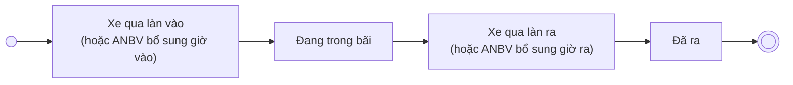
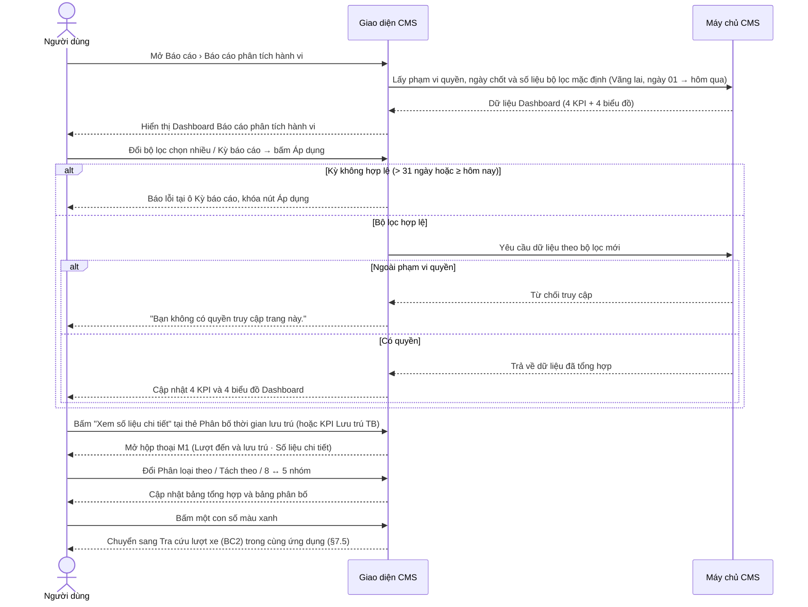
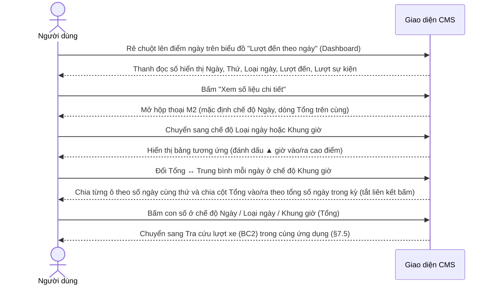
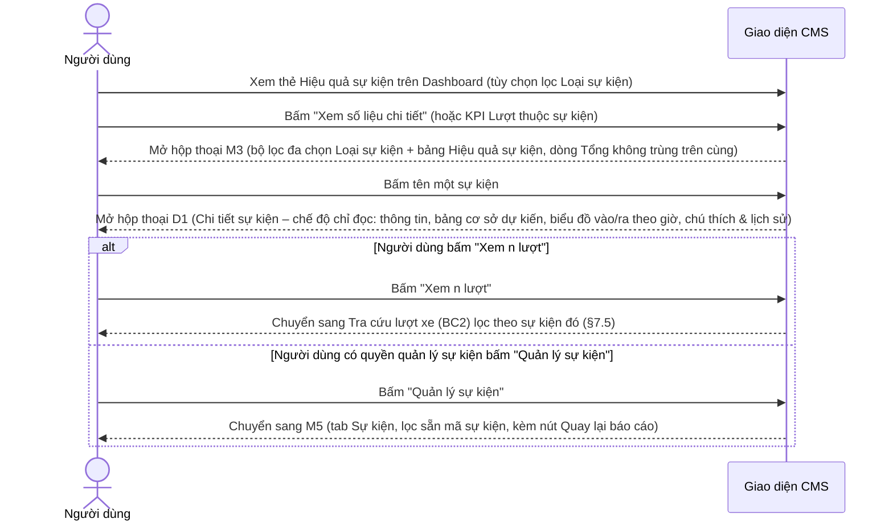
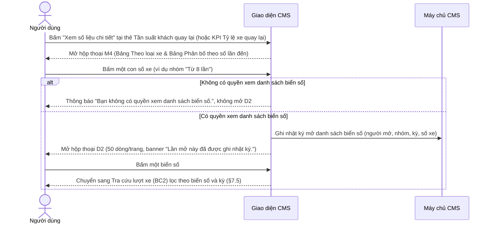
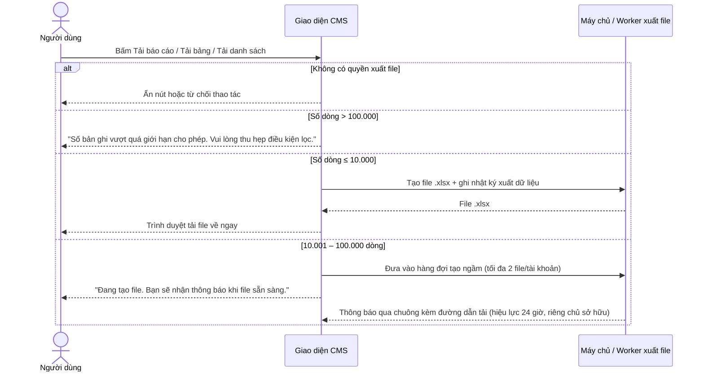
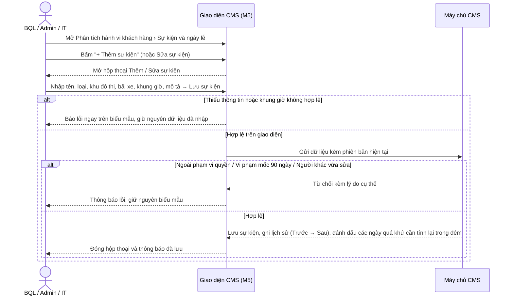

# PRD – TÀI LIỆU YÊU CẦU SẢN PHẨM
## BÁO CÁO PHÂN TÍCH HÀNH VI GỬI XE
**HỆ THỐNG CMS PARKING – VCR**  
`PRD-CMS117` · Version 0.4 (bản rút gọn – cập nhật theo giao diện mới)  
VSF – KHỐI QTVH SMART CITY  
Technopark, Vinhomes Ocean Park, Gia Lâm, Hà Nội  
26/11/2026

---

## MỤC LỤC
1. THÔNG TIN TÀI LIỆU
2. BUSINESS CONTEXT
   - 2.1 Vấn đề hiện tại
   - 2.2 Mục tiêu nghiệp vụ và nhu cầu thông tin
   - 2.3 Thuật ngữ
3. PHẠM VI
   - 3.1 Phụ thuộc – dữ liệu nguồn cần có trước
4. DESCRIPTION
   - 4.1 Hiện trạng
   - 4.2 Vòng đời lượt gửi xe
   - 4.3 Phân cấp đơn vị
   - 4.4 Quy tắc gắn nhãn và tính toán chỉ tiêu
5. PRE-CONDITION
6. POST-CONDITION
7. USE CASE
   - Ngoại lệ dùng chung cho Dashboard và các góc nhìn chi tiết (M1 – M4)
   - 7.1 Xem Dashboard tổng quan và Lượt đến – thời gian lưu trú (M1)
   - 7.2 Xem lượt đến theo thời gian (M2)
   - 7.3 Phân tích hiệu quả sự kiện (M3, D1)
   - 7.4 Xem khách quay lại (M4, D2)
   - 7.5 Tra cứu danh sách lượt tạo nên một con số (Tra cứu lượt xe của BC2)
   - 7.6 Xuất Excel
   - 7.7 Quản lý sự kiện, chú thích sự kiện và ngày lễ (M5)
8. BUSINESS RULES
9. FUNCTIONAL REQUIREMENTS
10. CHỈ TIÊU VÀ THAM SỐ
    - 10.1 Chỉ tiêu và cách tính
    - 10.2 Tham số hệ thống

---

## 1. THÔNG TIN TÀI LIỆU

| Hạng mục | Nội dung |
| :--- | :--- |
| **Tên tài liệu** | PRD-CMS117 – Báo cáo phân tích hành vi gửi xe (bản rút gọn) |
| **Khách hàng** | VCR |
| **Phạm vi** | • Màn hình **Báo cáo phân tích hành vi** dạng Dashboard hợp nhất trên CMS Parking cùng 4 góc nhìn số liệu chi tiết: *Lượt đến và lưu trú* (M1), *Theo thời gian* (M2), *Hiệu quả sự kiện* (M3, D1), *Khách quay lại* (M4, D2). • Chuyển trực tiếp từ mọi con số trên báo cáo sang màn **Tra cứu lượt xe** (BC2) trong cùng ứng dụng. • Xuất Excel (`.xlsx`) báo cáo tổng hợp theo mẫu 4.4 và bảng chi tiết theo từng góc nhìn. • Màn vận hành **Sự kiện và ngày lễ** (M5): khai báo sự kiện, ghi chú thích sự kiện và quản lý lịch ngày lễ dùng chung. |
| **Ngoài phạm vi** | • Hành vi mua sắm (giá trị hóa đơn, gian hàng ghé thăm) do hệ thống Parking không tích hợp dữ liệu POS và VinClub. • Tự động sinh nhận định, dự báo lưu lượng, xây dựng hồ sơ hành vi theo từng cá nhân. • Doanh thu theo sự kiện (thuộc *Báo cáo doanh thu* – BC3); công suất, tỷ lệ lấp đầy, cảnh báo ngoại lệ (thuộc *Báo cáo chỗ đỗ và xe ra vào* – BC2). • Phân tích sâu dưới cấp bãi xe; số liệu tức thời trong ngày hiện tại. • Luồng đề xuất – phê duyệt sự kiện; nhận diện xe sự kiện bằng danh sách đăng ký trước, voucher hoặc biển số đăng ký trước. |
| **Nguồn yêu cầu** | File *"Phân tích báo cáo TGX"* của VCR (sheet 4.4 BC Phân tích hành vi, Master Data nhóm 4, sheet *"Thông tin cần clear"*); góp ý VCR vòng 1; phản hồi của PO ngày 19/10/2026; cập nhật giao diện Dashboard và vận hành tháng 11/2026. |

---

## 2. BUSINESS CONTEXT

### 2.1 Vấn đề hiện tại
- Hệ thống Parking đã ghi nhận đầy đủ giờ vào, giờ ra, bãi xe, loại phương tiện và thẻ/biển số của từng lượt, nhưng chưa có bộ báo cáo tổng hợp cho biết khách đến vào khung giờ nào, đi phương tiện gì và ở lại bao lâu. Ban quản lý (BQL) phải xuất dữ liệu thô và tự tổng hợp thủ công.
- Chưa đo lường được hiệu quả thu hút khách của các sự kiện do hệ thống chưa có danh mục sự kiện và chưa thống nhất quy tắc xác định lượt thuộc sự kiện.
- Thời gian lưu trú trung bình dễ bị kéo lệch nếu tính gộp nhóm xe gửi cố định cả ngày (thuê bao cư dân, cán bộ nhân viên, khối văn phòng) với nhóm khách vãng lai đến vui chơi, mua sắm.
- Báo cáo chỗ đỗ (BC2) và báo cáo này cùng đo thời gian xe nằm trong bãi. Nếu hai báo cáo chia ngưỡng thời gian không tương thích, BQL sẽ nhận được các con số không khớp nhau cho cùng một câu hỏi nghiệp vụ.
- Hệ thống gửi xe không có dữ liệu giao dịch mua sắm nên không thể tự tính các nhận định định tính (ví dụ *"khách sự kiện mua sắm nhiều"* trong mẫu 4.4). Thay vào đó, BQL cần nơi ghi nhận chú thích nghiệp vụ gắn liền với từng sự kiện để đối chiếu khi báo cáo.

### 2.2 Mục tiêu nghiệp vụ và nhu cầu thông tin

| Nhu cầu | Câu hỏi nghiệp vụ cần trả lời | Người dùng | Màn hình / Góc nhìn | Mẫu 4.4 |
| :--- | :--- | :--- | :--- | :--- |
| **Tổng quan hành vi** | Nhìn nhanh trong kỳ có bao nhiêu lượt đến, lưu trú trung bình bao lâu, bao nhiêu lượt thuộc sự kiện và tỷ lệ xe quay lại là bao nhiêu? | BQL, Ban Vận hành | Dashboard Báo cáo phân tích hành vi | Tổng quan |
| **Lượt đến và lưu trú** | Khách đi phương tiện gì, ở lại bao lâu (trung bình, trung vị, ngắn nhất, dài nhất, phân bố theo nhóm thời gian)? | BQL, Ban Vận hành | Dashboard + Chi tiết M1 | §1, §2 |
| **So sánh sự kiện và ngày thường** | Khách đến trong khung giờ sự kiện có ở lâu hơn, đi ô tô nhiều hơn hay đến vào khung giờ khác so với ngày thường không? | BQL, Ban Vận hành | Chi tiết M1 | §3, §4 |
| **Theo thời gian** | Ngày nào, loại ngày nào, khung giờ nào đông khách; giờ vào và giờ ra cao điểm là lúc nào để bố trí nhân sự làn? | BQL | Dashboard + Chi tiết M2 | §5 |
| **Hiệu quả từng sự kiện** | Mỗi sự kiện thu hút bao nhiêu lượt, tăng thêm bao nhiêu so với mức dự kiến ngày thường, khách đến và rời đi lúc nào, BQL ghi nhận chú thích gì? | BQL, Ban Vận hành | Dashboard + Chi tiết M3, D1 | §6 |
| **Khách quay lại** | Có bao nhiêu xe đến từ 2 lần trở lên trong kỳ, tỷ lệ khách quen (đã từng đến trước kỳ) là bao nhiêu? | Ban Vận hành, BQL | Dashboard + Chi tiết M4, D2 | Master Data |
| **Chi tiết từng lượt** | Những lượt gửi xe cụ thể nào tạo nên một con số trên báo cáo? | BQL, Hậu kiểm | Tra cứu lượt xe (BC2) | §7 |
| **Báo cáo cấp trên** | Xuất file Excel tổng hợp theo bố cục mẫu 4.4 và bảng chi tiết theo từng góc nhìn. | BQL, Ban Vận hành | Dashboard, M1 – M4, D2 | Toàn bộ |
| **Khai báo sự kiện, ngày lễ** | Quản lý danh mục sự kiện, khung giờ, chú thích sự kiện và lịch ngày lễ toàn hệ thống. | BQL, Admin, IT VCR | M5 (*Sự kiện và ngày lễ*) | Master Data |

> **Lưu ý về bố cục hiển thị:** Mẫu 4.4 của VCR là cơ sở xác định đầy đủ nhu cầu thông tin. Trên giao diện CMS, 4 nhóm phân tích được hợp nhất vào một màn hình **Dashboard trực quan** kèm các hộp thoại **Số liệu chi tiết** để giảm thao tác chuyển trang và loại bỏ các chỉ số trùng lặp; file Excel tổng hợp tải từ Dashboard vẫn giữ đủ cấu trúc các sheet theo mẫu 4.4 (§7.6).

### 2.3 Thuật ngữ

**Quy ước ký hiệu:** `M1 – M4` (4 góc nhìn chi tiết trên Dashboard), `D1, D2` (hộp thoại chi tiết sự kiện / danh sách biển số), `M5` (màn vận hành Sự kiện và ngày lễ) · `BR` (quy tắc nghiệp vụ, §8) · `FR` (yêu cầu chức năng, §9) · `C-xx` (chỉ tiêu), `P-xx` (tham số) (§10) · `D-xx` (dữ liệu nguồn, §3.1) · `AC, EX` (nghiệm thu, ngoại lệ, §7). `BC2`: *Báo cáo chỗ đỗ và xe ra vào* (PRD-CMS115); `BC3`: *Báo cáo doanh thu* (PRD-CMS116).

| Thuật ngữ | Định nghĩa |
| :--- | :--- |
| **Khu đô thị** | Cấp đơn vị quản lý trên CMS, là cấp quản lý trực tiếp các bãi xe (*Khu đô thị → Bãi xe*, §4.3). |
| **Lượt đến** | Lượt gửi xe có **giờ vào** nằm trong kỳ báo cáo (từ `00:00:00` ngày đầu đến `23:59:59` ngày cuối theo giờ Việt Nam – GMT+7). Mọi chỉ tiêu của báo cáo đều tính trên tập lượt đến (BR01). |
| **Lượt có lưu trú** | Lượt đến đã ghi nhận giờ ra (tính đến hết ngày chốt dữ liệu), không phải lượt bổ sung và có giờ ra không sớm hơn giờ vào. Chỉ nhóm lượt này được đưa vào tính thời gian lưu trú (BR06). |
| **Thời gian lưu trú** | Khoảng thời gian `giờ ra − giờ vào` của một lượt, tính bằng phút (bỏ phần giây); là cùng đại lượng với *"thời gian đỗ"* trong BC2. **Trung vị** là giá trị nằm chính giữa khi sắp xếp thời gian lưu trú từ thấp đến cao, giúp tránh bị kéo lệch bởi một số ít lượt gửi quá dài. |
| **Lượt bổ sung** | Lượt có giờ vào hoặc giờ ra do An ninh bảo vệ (ANBV) tạo bổ sung thủ công khi làn thiếu ghi nhận. Lượt bổ sung vẫn được đếm là *Lượt đến*, nhưng bị loại khỏi thống kê thời gian lưu trú do mốc giờ vào/ra không đủ tin cậy. |
| **Loại khách** | Gồm `Vãng lai`, `Thuê bao`, `VIP` hoặc `Chưa xác định`, được xác định tại thời điểm xe vào bãi (BR03). |
| **Sự kiện & Khung giờ sự kiện** | Hoạt động do BQL/TTTM tổ chức, được khai báo tại màn M5 kèm khu đô thị, phạm vi bãi xe và một hoặc nhiều khung giờ (ví dụ `19/09/2026 17:00 – 22:00`). Nếu muốn tính cả lượng xe đến sớm trước giờ khai mạc, BQL khai báo giờ bắt đầu khung giờ sớm tương ứng. |
| **Lượt sự kiện / Lượt không sự kiện** | **Lượt sự kiện** là lượt đến tại bãi thuộc phạm vi sự kiện và có giờ vào nằm trong ít nhất một khung giờ của sự kiện đó (BR04). Việc gắn nhãn dựa hoàn toàn vào khung giờ và bãi xe, không khẳng định chắc chắn 100% khách đến vì sự kiện. Các lượt còn lại gọi là **lượt không sự kiện** (tương ứng nhóm *"xe hàng ngày"* trong mẫu 4.4). |
| **Lượt dự kiến & Lượt tăng thêm** | **Lượt dự kiến** là số lượt thông thường tại cùng phạm vi bãi, cùng thứ, cùng khung giờ (và cùng bộ lọc phương tiện, loại khách) khi không có sự kiện và không phải ngày lễ, tính bằng trung bình tối đa 4 tuần gần nhất (tìm lùi tối đa 8 tuần, cần tối thiểu 2 tuần). **Lượt tăng thêm** = `Lượt sự kiện − Lượt dự kiến` (BR12). |
| **Khách quen** | Biển số hợp lệ đã phát sinh ít nhất 1 lượt gửi xe tại các khu đô thị đang xem trong vòng 90 ngày trước ngày bắt đầu kỳ báo cáo (BR14). |

---

## 3. PHẠM VI

- **Trong phạm vi:**
  - Màn hình Dashboard **Báo cáo phân tích hành vi** hợp nhất với bộ lọc đa chọn dùng chung, 4 thẻ KPI tổng quan, 4 thẻ biểu đồ trực quan và 4 hộp thoại *Số liệu chi tiết* (M1 – M4), kèm hộp thoại *Chi tiết sự kiện* (D1) và *Danh sách biển số* (D2).
  - Màn hình vận hành **Phân tích hành vi khách hàng › Sự kiện và ngày lễ** (M5) để quản lý danh mục sự kiện, chú thích sự kiện và lịch ngày lễ dùng chung.
  - Chuyển tiếp trong cùng ứng dụng sang màn **Tra cứu lượt xe** (BC2) từ mọi con số/điểm dữ liệu bấm được trên báo cáo.
  - Xuất Excel (`.xlsx`) báo cáo tổng hợp theo mẫu 4.4, bảng chi tiết từng góc nhìn và danh sách biển số.
  - Giới hạn dữ liệu theo khu đô thị và tách quyền chức năng theo cơ chế phân quyền hiện hành của CMS Parking.
- **Ngoài phạm vi:** Như mô tả tại mục §1.

### 3.1 Phụ thuộc – dữ liệu nguồn cần có trước

| Mã | Dữ liệu cần có | Hiện trạng → Cách xử lý |
| :--- | :--- | :--- |
| **D-01** | Lượt gửi xe: giờ vào, giờ ra, bãi xe, làn, mã thẻ/vé, biển số camera đọc | Đã có → dùng chung nguồn với BC2. |
| **D-02** | Loại phương tiện trên lượt (*Ô tô*, *Xe máy*, *Xe đạp*) | Đồng bộ theo BC2: vé QR (mã bắt đầu bằng `QR-`) tính là *Ô tô*; lượt chưa có loại phương tiện hợp lệ xếp vào `Chưa xác định`. |
| **D-03** | Nguồn ghi nhận vào/ra của lượt (làn tự động hay ANBV bổ sung) | Dùng chung với BC2 → dùng để loại lượt bổ sung khỏi thống kê lưu trú. |
| **D-04** | Loại thẻ và lịch sử hiệu lực thuê bao tại thời điểm xe vào | Đã có dữ liệu thuê bao; cần lưu lịch sử hiệu lực để xác định đúng *Loại khách* cho các lượt quá khứ. |
| **D-05** | Danh mục sự kiện kèm phạm vi bãi, khung giờ và chú thích | Xây mới tại màn **Sự kiện và ngày lễ** (M5). |
| **D-06** | Lịch ngày lễ dùng chung toàn hệ thống | Quản lý tại tab **Ngày lễ** của màn M5 (dùng chung với BC2). |
| **D-07** | Màn **Tra cứu lượt xe** (BC2) bổ sung bộ lọc và cột *Loại khách*, *Sự kiện*, *Nhóm thời gian lưu trú* | Đã tích hợp đồng bộ cùng BC2 (FR13), nhận tham số lọc truyền từ BC4 và hỗ trợ nút *Quay lại báo cáo*. |

> **Tác động khi thiếu dữ liệu nguồn:** Nếu chưa khai báo D-05, toàn bộ lượt được xếp vào *Không sự kiện* và mục *Hiệu quả sự kiện* không có số liệu. Nếu chưa khai báo D-06 cho năm của kỳ báo cáo, loại ngày chỉ phân thành *Ngày thường* và *Cuối tuần* kèm dòng nhắc chưa khai báo ngày lễ. Nếu thiếu quyền hoặc chưa tích hợp D-07, người dùng không mở được danh sách lượt chi tiết từ báo cáo.

---

## 4. DESCRIPTION

CMS Parking cung cấp **01 màn hình Báo cáo tổng hợp** (dạng Dashboard kèm 4 hộp thoại Số liệu chi tiết chỉ đọc) và **01 màn hình Vận hành** để khai báo dữ liệu đầu vào (sự kiện, chú thích, ngày lễ):

| Mã | Menu trên CMS Parking | Chức năng chính / Câu hỏi trả lời | Chế độ | UC |
| :--- | :--- | :--- | :--- | :--- |
| **Dashboard & M1** | `Báo cáo › Báo cáo phân tích hành vi` (Tổng quan + Chi tiết *Lượt đến và lưu trú*) | Theo dõi 4 KPI tổng quan, 4 biểu đồ hành vi; phân tích sâu lượt đến, lưu trú theo loại xe / sự kiện / loại khách và tách theo khu đô thị, bãi xe. | Chỉ đọc | 7.1 |
| **M2** | Chi tiết *Theo thời gian* (mở từ thẻ *Lượt đến theo ngày*) | Xác định ngày, loại ngày, khung giờ đông khách; giờ vào và giờ ra cao điểm. | Chỉ đọc | 7.2 |
| **M3, D1** | Chi tiết *Hiệu quả sự kiện* & hộp thoại *Chi tiết sự kiện* (mở từ thẻ *Hiệu quả sự kiện*) | Đánh giá lượt thực tế, lượt dự kiến, lượt tăng thêm, biểu đồ vào/ra theo giờ và xem chú thích của từng sự kiện. | Chỉ đọc | 7.3 |
| **M4, D2** | Chi tiết *Khách quay lại* & hộp thoại *Danh sách biển số* (mở từ thẻ *Tần suất khách quay lại*) | Đánh giá tần suất quay lại theo loại xe và nhóm số lần đến; tra cứu danh sách biển số (theo quyền riêng). | Chỉ đọc | 7.4 |
| **BC2** | `Quản lý chỗ đỗ › Tra cứu lượt xe` | Xem danh sách lượt gửi xe chi tiết tạo nên bất kỳ con số nào trên báo cáo (chuyển trong cùng ứng dụng). | Chỉ đọc / Tra cứu | 7.5 |
| **M5** | `Phân tích hành vi khách hàng › Sự kiện và ngày lễ` | Thêm, sửa, xóa mềm sự kiện; thêm/sửa chú thích sự kiện; quản lý lịch ngày lễ toàn hệ thống và xem lịch sử thay đổi. | Ghi dữ liệu | 7.7 |

### 4.1 Hiện trạng
- Lượt gửi xe được ghi nhận tại làn: xe máy dùng thẻ từ, ô tô vãng lai nhận vé QR tại trụ thông minh. Ứng dụng kiểm soát dự phòng khi mất điện chưa triển khai (dự kiến từ 03/2027).
- Khi làn thiếu ghi nhận giờ vào hoặc giờ ra, ANBV tạo bổ sung giờ vào/ra trên hệ thống (*lượt bổ sung*).
- Trước khi triển khai báo cáo này, các sự kiện (triển lãm, lễ hội, hội thảo, khuyến mại, biểu diễn...) chỉ được theo dõi rời rạc bên ngoài CMS.
- Hệ thống gửi xe không có dữ liệu mua sắm.
- Hệ thống tổ chức đơn vị theo 2 cấp: **Khu đô thị → Bãi xe** (không có cấp Trung tâm thương mại).

### 4.2 Vòng đời lượt gửi xe
Báo cáo sử dụng chung mô hình vòng đời 2 trạng thái với BC2 và BC3. Toàn bộ màn hình báo cáo chỉ đọc dữ liệu, không làm thay đổi trạng thái của lượt gửi xe.

*Hình 1. Vòng đời 2 trạng thái của lượt gửi xe*

| Trạng thái | Điều kiện chuyển trạng thái | Cách sử dụng trong báo cáo này |
| :--- | :--- | :--- |
| **Đang trong bãi** | Xe qua làn vào, hoặc ANBV bổ sung giờ vào. | Tính vào *Lượt đến*; chưa tính vào *Có lưu trú*. |
| **Đã ra** | Xe qua làn ra, hoặc ANBV bổ sung giờ ra (trước mốc chốt số liệu). | Tính vào *Lượt đến*; tính vào *Có lưu trú* nếu không phải lượt bổ sung và giờ ra ≥ giờ vào. |

**Các thuộc tính KHÔNG lưu thành trạng thái vòng đời (do suy diễn được từ dữ liệu sẵn có):**

| Thuộc tính | Cách xử lý | Lý do |
| :--- | :--- | :--- |
| **Ra không thu đủ** | Cờ tính toán (chỉ dùng ở BC3) | Suy ra từ `phải thu > thực thu`, có thể thay đổi sau khi xe đã ra (QR đối soát muộn, thu bù, hoàn tiền) và có thể đồng thời tồn tại cùng miễn giảm. Báo cáo hành vi không sử dụng dữ liệu tiền. |
| **Hủy** | Không áp dụng | Lượt thiếu/sai được ANBV xử lý bằng cách bổ sung giờ vào/ra hoặc hiệu chỉnh biển số; lượt trùng từ app mất điện (nếu có) được loại ngay khi đồng bộ theo cơ chế của BC2. |
| **Tồn bất thường** | Cờ tính toán của BC2 | Suy ra từ trạng thái *Đang trong bãi* và thời gian đỗ vượt ngưỡng cảnh báo; thay đổi động theo ngưỡng cấu hình. |
| **Lượt bổ sung** | Thuộc tính nguồn ghi nhận | Lượt bổ sung vẫn đi qua đúng 2 trạng thái chuẩn; báo cáo chỉ dựa vào thuộc tính nguồn vào/ra để loại khỏi thống kê thời gian lưu trú (BR06). |
| **Lượt sự kiện, Loại khách** | Nhãn phân loại của lượt | Một lượt có thể đồng thời thuộc nhiều sự kiện và nhãn sự kiện được tính lại khi BQL sửa cấu hình sự kiện (BR16); đây là thông tin phân loại, không phải trạng thái vật lý của xe. |

### 4.3 Phân cấp đơn vị
- Báo cáo áp dụng trực tiếp phân cấp sẵn có **Khu đô thị → Bãi xe** (không bổ sung cấp Trung tâm thương mại – TTTM):
  - Mỗi sự kiện được khai báo thuộc một *Khu đô thị* với phạm vi gồm một hoặc nhiều *Bãi xe* trong khu đó.
  - Chỉ tiêu *Khách quay lại* và *Khách quen* được xét trong phạm vi các *Khu đô thị* đang chọn.
  - *Lịch ngày lễ* dùng chung cho toàn hệ thống; phân quyền truy cập dữ liệu áp dụng theo *Khu đô thị*.
  - Tầng đỗ không có trạm kiểm soát riêng thì gộp chung trong bãi; tầng có trạm kiểm soát riêng được khai báo như một bãi xe độc lập.
- Chỉ cần bổ sung cấp TTTM trong tương lai nếu một khu đô thị có nhiều TTTM do các BQL tách biệt vận hành và VCR yêu cầu tổng hợp/phân quyền riêng theo từng TTTM.

### 4.4 Quy tắc gắn nhãn và tính toán chỉ tiêu
1. **Xác định lượt thuộc kỳ theo giờ vào (BR01):** Xe vào trước ngày đầu kỳ nhưng ra trong kỳ không được tính vào báo cáo kỳ này.
2. **Mặc định lọc khách Vãng lai (BR03):** Khi mở báo cáo, bộ lọc *Loại khách* chọn sẵn **Vãng lai** vì nhóm *Thuê bao* và *VIP* gửi xe theo lịch sinh hoạt/làm việc cố định, dễ làm lệch thời gian lưu trú và tỷ lệ quay lại của khách vãng lai. Người dùng có thể chọn thêm các loại khách khác khi cần; nếu có chọn *Thuê bao* (hoặc *Tất cả loại khách*), giao diện hiển thị dòng nhắc ngay phía trên KPI.
3. **Hai chiều phân loại độc lập:** Mỗi lượt đồng thời mang 2 nhãn độc lập là **Loại khách** (*Vãng lai / Thuê bao / VIP / Chưa xác định*) và **Sự kiện** (*Sự kiện / Không sự kiện*). Tổng các nhóm trong cùng một chiều luôn bằng tổng số lượt đến; tuyệt đối không cộng chéo nhóm của chiều này với nhóm của chiều kia.
4. **Xác định lượt sự kiện theo giờ vào (BR04):** Một lượt được gắn nhãn thuộc sự kiện X nếu xe vào tại bãi thuộc phạm vi X và có `giờ bắt đầu khung ≤ giờ vào < giờ kết thúc khung`. BQL muốn tính cả khách đến sớm trước giờ khai mạc thì khai báo giờ bắt đầu khung sớm hơn tương ứng (không tách tham số "thời gian đến sớm" riêng).
   - *Ví dụ minh họa (Khu đô thị A, ngày 19/09/2026):* Có **SK-03** (*Hầm B1, Hầm B2*, `17:00 – 22:00`) và **SK-04** (*Hầm B1*, `18:00 – 20:00`):
     - Xe vào Hầm B1 lúc `16:40` → **Không thuộc sự kiện** (trước `17:00`).
     - Xe vào Hầm B1 lúc `17:00` → Thuộc **SK-03**.
     - Xe vào Hầm B1 lúc `18:10` → Thuộc **cả SK-03 và SK-04** (nhưng chỉ đếm 1 lần khi tổng hợp *Sự kiện*).
     - Xe vào Hầm B2 lúc `18:30` → Chỉ thuộc **SK-03** (Hầm B2 nằm ngoài phạm vi SK-04).
     - Xe vào Hầm B2 lúc `19:00`, ra lúc `23:30` → Vẫn thuộc **SK-03** (xét theo giờ vào, không phụ thuộc giờ ra).
     - Xe vào Hầm B1 đúng `20:00` → Chỉ thuộc **SK-03** (không thuộc SK-04 do cận trên không bao gồm `20:00`).
     - Xe vào Hầm B1 lúc `21:30`, đang trong bãi lúc chốt → Thuộc **SK-03** (đếm vào lượt sự kiện, chưa có thời gian lưu trú).
5. **Tương thích 8 nhóm thời gian lưu trú (BR08):** Mỗi nhóm áp dụng quy ước nửa mở `[cận dưới, cận trên)` — **bao gồm mốc đầu và không bao gồm mốc cuối** (ví dụ lượt đúng 30 phút thuộc `D03`, không thuộc `D02`). Hệ thống dùng 8 nhóm chi tiết gộp khớp hoàn toàn vào 5 nhóm của BC2 và 4 nhóm so sánh của mẫu 4.4:

| Mã | Nhóm chi tiết (8 nhóm) | Nhóm gộp của BC2 (5 nhóm) | Nhóm so sánh mẫu 4.4 (4 nhóm) |
| :--- | :--- | :--- | :--- |
| **D01** | Dưới 15 phút (`0 – <15`) | Dưới 15 phút | Dưới 30 phút |
| **D02** | 15 – dưới 30 phút (`15 – <30`) | 15 – dưới 60 phút | Dưới 30 phút |
| **D03** | 30 – dưới 60 phút (`30 – <60`) | 15 – dưới 60 phút | 30 phút – dưới 2 giờ |
| **D04** | 1 – dưới 2 giờ (`60 – <120`) | 1 – dưới 4 giờ | 30 phút – dưới 2 giờ |
| **D05** | 2 – dưới 4 giờ (`120 – <240`) | 1 – dưới 4 giờ | 2 – dưới 4 giờ |
| **D06** | 4 – dưới 6 giờ (`240 – <360`) | 4 – dưới 8 giờ | Từ 4 giờ |
| **D07** | 6 – dưới 8 giờ (`360 – <480`) | 4 – dưới 8 giờ | Từ 4 giờ |
| **D08** | Từ 8 giờ (`≥ 480`) | Từ 8 giờ | Từ 4 giờ |

6. **Lượt dự kiến của sự kiện (BR12):** Do lượt sự kiện bao gồm cả lượng khách tự nhiên vẫn đến vào ngày thường, hệ thống ước lượng *Lượt dự kiến* bằng trung bình số lượt ở cùng phạm vi bãi, cùng thứ, cùng khung giờ (và cùng bộ lọc phương tiện, loại khách) trong tối đa **4 tuần** gần nhất không có sự kiện tại khu đô thị và không phải ngày lễ (tìm lùi tối đa **8 tuần**, tối thiểu **2 tuần**).
   - *Ví dụ minh họa:* SK-03 *Lễ hội ẩm thực* (Thứ 7 ngày `19/09/2026`, `17:00 – 22:00`) có 4 Thứ 7 đối chiếu hợp lệ đạt `1.070`, `1.023`, `1.099`, `1.070` lượt → Lượt dự kiến = `1.065,5`; lượt thực tế = `2.059` → Tăng thêm `+993,5` lượt (`+93,2%`).

---

## 5. PRE-CONDITION
1. Người dùng đã đăng nhập CMS và được phân quyền xem *Báo cáo phân tích hành vi* trên ít nhất một khu đô thị (hoặc quyền quản lý sự kiện / quản lý ngày lễ khi truy cập M5).
2. Dữ liệu lượt gửi xe có đủ giờ vào, giờ ra, bãi xe, loại phương tiện, nguồn ghi nhận (D-01 – D-03) và xác định được loại khách tại giờ vào (D-04).
3. Danh mục sự kiện trong kỳ và lịch ngày lễ của năm đã được khai báo tại M5 (D-05, D-06).
4. Số liệu tổng hợp định kỳ đã chạy đến hết ngày hôm qua (trường hợp chậm tổng hợp sẽ hiển thị cảnh báo theo ngoại lệ `EX-BC4-7.0-03`).

---

## 6. POST-CONDITION
1. Người dùng chỉ xem được số liệu thuộc các khu đô thị trong phạm vi phân quyền và khớp chính xác với bộ lọc đã áp dụng.
2. Màn hình báo cáo luôn thể hiện rõ mốc dữ liệu chốt (`Số liệu đến 23:59:59 dd/mm/yyyy · GMT+7`) và phạm vi kỳ/loại khách đang xem.
3. Mọi con số hoặc điểm biểu đồ bấm được khi mở sang màn **Tra cứu lượt xe** (BC2) đều hiển thị tổng số dòng khớp đúng với con số vừa bấm; nút *Quay lại báo cáo* khôi phục nguyên ngữ cảnh trước đó.
4. File Excel xuất ra khớp số liệu hiển thị trên màn hình tại thời điểm xuất.
5. Toàn bộ màn hình báo cáo (Dashboard, M1 – M4, D1, D2) ở chế độ **chỉ đọc**, không làm thay đổi dữ liệu lượt gửi xe. Chỉ màn **Sự kiện và ngày lễ (M5)** thực hiện ghi dữ liệu (thêm/sửa/xóa sự kiện, ghi chú thích sự kiện, quản lý ngày lễ), và mọi thao tác ghi hoặc mở danh sách biển số/xuất file đều được lưu nhật ký đầy đủ.

---

## 7. USE CASE

### Ngoại lệ dùng chung cho Dashboard và các góc nhìn chi tiết (M1 – M4)

| ID | Tình huống | Cách xử lý |
| :--- | :--- | :--- |
| **EX-BC4-7.0-01** | Kỳ báo cáo không hợp lệ: thiếu ngày, ngày bắt đầu sau ngày kết thúc, ngày kết thúc từ hôm nay trở đi, hoặc khoảng thời gian dài hơn 31 ngày. | Hiển thị thông báo lỗi ngay dưới ô *Kỳ báo cáo* và vô hiệu hóa nút **Áp dụng**; không chạy báo cáo. |
| **EX-BC4-7.0-02** | Người dùng không có quyền xem báo cáo, hoặc cố truy cập khu đô thị / bãi xe ngoài phạm vi phân quyền. | Không hiển thị số liệu; hiển thị thông báo lỗi *"Bạn không có quyền truy cập trang này."* |
| **EX-BC4-7.0-03** | Số liệu ngày hôm qua chưa tổng hợp xong (ngày chốt nhỏ hơn ngày hôm qua). | Hiển thị số liệu chốt đến ngày gần nhất đã có; hiện banner cảnh báo vàng: *"Đang dùng số liệu đến dd/mm/yyyy. Số liệu ngày dd/mm/yyyy đang được tổng hợp."* |
| **EX-BC4-7.0-04** | Sự kiện hoặc ngày lễ vừa được thêm, sửa, xóa ảnh hưởng đến các ngày đã qua nằm trong kỳ đang xem. | Vẫn giữ số liệu theo ảnh chụp đã chốt; hiện banner thông tin màu xanh: *"Số liệu sẽ được tính lại trong đêm cho các ngày dd/mm/yyyy, ..."* |
| **EX-BC4-7.0-05** | Một nhóm có ít hơn 30 lượt có lưu trú (P-06). | Các giá trị *Trung bình*, *Trung vị* và *Tỷ lệ lưu trú* của nhóm hiển thị chữ xám kèm biểu tượng `ⓘ`; rê chuột hoặc focus hiện chú thích *"Ít dữ liệu, không nên dùng để so sánh"*. |
| **EX-BC4-7.0-06** | Lượt chưa xác định được loại xe hoặc loại khách. | Xếp vào dòng `Chưa xác định` ở cuối bảng (chỉ hiển thị dòng này khi có ít nhất 1 lượt phát sinh); vẫn cộng vào dòng Tổng. |
| **EX-BC4-7.0-07** | Không có lượt nào thỏa điều kiện lọc. | Các chỉ tiêu số lượt hiển thị `0`; chỉ tiêu thời gian lưu trú, tỷ lệ và giờ cao điểm hiển thị `"—"`; các thẻ biểu đồ hiển thị trạng thái trống tương ứng. |
| **EX-BC4-7.0-08** | (a) Lỗi hệ thống khi tải số liệu; (b) Người dùng thay đổi bộ lọc trong lúc yêu cầu cũ đang xử lý. | (a) Hiển thị banner lỗi kèm mã tham chiếu (ví dụ `BC4-01`) và liên kết **Thử lại**, giữ nguyên bộ lọc đã chọn; (b) Hủy kết quả cũ và chỉ hiển thị kết quả của bộ lọc mới nhất. |
| **EX-BC4-7.0-09** | Người dùng chọn riêng một phương tiện là **Xe đạp**. | Thẻ KPI *Tỷ lệ xe quay lại* hiển thị `"—"` (*Không áp dụng cho Xe đạp*); thẻ biểu đồ *Tần suất khách quay lại* hiển thị thông báo không áp dụng cho Xe đạp (do xe đạp không có biển số). |

> *(Hình 2. Minh họa các trạng thái màn hình: chưa chạy báo cáo, banner số liệu chưa tổng hợp / chờ tính lại trong đêm, kỳ báo cáo lỗi, cảnh báo ít dữ liệu dưới 30 lượt, lỗi tải số liệu — cập nhật ảnh chụp theo giao diện mới)*

---

### 7.1 Xem Dashboard tổng quan và Lượt đến – thời gian lưu trú (M1)

#### 7.1.1 Business Flow
1. Người dùng mở menu **Báo cáo › Báo cáo phân tích hành vi**. Hệ thống tự động điền sẵn bộ lọc mặc định: tất cả khu đô thị được phân quyền, tất cả bãi xe, tất cả phương tiện, loại khách **Vãng lai**, kỳ báo cáo từ ngày `01` của tháng chứa ngày hôm qua đến hết ngày hôm qua (nếu hôm nay là ngày `01` thì tự lấy trọn tháng trước) và chạy hiển thị Dashboard ngay.
2. Trên Dashboard, người dùng có thể điều chỉnh các bộ lọc chọn nhiều (*Khu đô thị*, *Bãi xe*, *Phương tiện*, *Loại khách*) và *Kỳ báo cáo* (hoặc bấm 3 nút chọn nhanh *Tháng này*, *Tháng trước*, *7 ngày trước*). Khi bộ lọc đang sửa khác với bộ lọc đang hiển thị, hệ thống gắn nhãn `Chưa áp dụng`. Người dùng bấm **Áp dụng** để cập nhật số liệu, hoặc bấm **Xóa bộ lọc** để đưa Khu đô thị / Bãi xe / Phương tiện về Tất cả và Loại khách về mặc định *Vãng lai* (giữ nguyên kỳ báo cáo).
3. Hệ thống hiển thị đồng bộ **4 thẻ KPI tổng quan** và **4 thẻ biểu đồ** (lưới 2×2): *Lượt đến theo ngày*, *Phân bố thời gian lưu trú*, *Hiệu quả sự kiện*, *Tần suất khách quay lại*.
4. Để xem sâu số liệu *Lượt đến và lưu trú* (M1), người dùng bấm vào thẻ KPI **Lưu trú trung bình** hoặc nút **Xem số liệu chi tiết ↗** ở cuối thẻ *Phân bố thời gian lưu trú*. Hộp thoại (Overlay rộng) *Lượt đến và lưu trú · Số liệu chi tiết* mở ra.
5. Trong hộp thoại M1, người dùng chọn tiêu chí **Phân loại theo** (*Loại xe*, *Sự kiện / Không sự kiện*, *Loại khách*), **Tách theo** (*Không tách*, *Khu đô thị*, *Bãi xe*), và chuyển đổi cấu trúc bảng thứ hai (*Nhóm lưu trú* ↔ *Loại xe*; *8 nhóm* ↔ *5 nhóm (BC2)*).
6. Người dùng bấm vào bất kỳ con số màu xanh nào để mở màn **Tra cứu lượt xe (BC2)** (§7.5), hoặc bấm **Tải báo cáo** (trên Dashboard) / **Tải bảng** (trong hộp thoại M1) để xuất Excel (§7.6).

#### 7.1.2 User Flow

*Hình 3. Sơ đồ tương tác – Xem Dashboard và Chi tiết Lượt đến – thời gian lưu trú*

#### 7.1.3 Màn hình
> *(Hình 4a. Dashboard Báo cáo phân tích hành vi – 4 KPI & 4 biểu đồ; Hình 4b. Hộp thoại M1 – Lượt đến và lưu trú · Số liệu chi tiết theo Loại xe / Sự kiện — cần chụp màn hình theo giao diện mới)*

| Thành phần | Mô tả |
| :--- | :--- |
| **Thanh tiêu đề & Nút tải báo cáo** | Đường dẫn `Báo cáo › Báo cáo phân tích hành vi`, tiêu đề trang, mốc dữ liệu `Số liệu đến 23:59:59 dd/mm/yyyy · GMT+7` và nút **Tải báo cáo** (xuất Excel tổng hợp, chỉ hiện với người có quyền xuất file). |
| **Bộ lọc tra cứu dùng chung** | Áp dụng đồng thời cho cả Dashboard và 4 hộp thoại chi tiết: • **4 bộ lọc chọn nhiều** (*Khu đô thị*, *Bãi xe*, *Phương tiện*, *Loại khách*): hỗ trợ chọn nhiều checkbox, nút `Chỉ chọn` và `Tất cả ...`. Quy tắc: trong cùng bộ lọc khớp một trong các lựa chọn (OR), giữa các bộ lọc đáp ứng đồng thời (AND). Khi đổi *Khu đô thị*, các bãi không còn thuộc khu đã chọn tự động bị bỏ kèm thông báo nhắc kiểm tra lại. Tên bãi hiển thị kèm tên khu đô thị viết tắt (`Tên bãi · Khu`). *Loại khách* mặc định chọn **Vãng lai**. • **Kỳ báo cáo:** Ô `Từ ngày → Đến ngày` kèm 3 nút chọn nhanh (*Tháng này*, *Tháng trước*, *7 ngày trước*) và ghi chú *"Lượt được tính theo giờ xe vào bãi trong kỳ đã chọn."* • Nút **Xóa bộ lọc**, nhãn **Chưa áp dụng** và nút **Áp dụng**. |
| **Dòng tóm tắt phạm vi kết quả** | Hiển thị `dd/mm/yyyy – dd/mm/yyyy · <Loại khách đang lọc>`. Nếu chọn *Tất cả loại khách* hoặc có bao gồm *Thuê bao*, hiển thị thêm cảnh báo màu nâu: *"Đang gộp cả khách Thuê bao (tỷ lệ quay lại & lưu trú sẽ gồm xe gửi cố định)"*. |
| **4 thẻ KPI tổng quan** | 1. **Lượt đến:** Tổng số lượt đến + phụ đề `{n} lượt đã ra` → bấm mở thẳng *Tra cứu lượt xe* (BC2). 2. **Lưu trú trung bình:** `{x} phút` (hoặc `—`) + phụ đề `Trên {n} lượt có lưu trú` → bấm mở hộp thoại chi tiết **M1**. 3. **Lượt thuộc sự kiện:** Tổng lượt thuộc ≥ 1 sự kiện + phụ đề `{x}% tổng lượt đến` → bấm mở hộp thoại chi tiết **M3**. 4. **Tỷ lệ xe quay lại:** `{x}%` + phụ đề `{n} xe đến từ 2 lần` (hoặc `—` nếu chỉ lọc *Xe đạp*) → bấm mở hộp thoại chi tiết **M4**. |
| **Thẻ biểu đồ Phân bố thời gian lưu trú (Dashboard)** | Phụ đề `Trung vị {x} phút · {n} lượt hợp lệ`. Biểu đồ thanh ngang 8 nhóm lưu trú (`Dưới 15 phút` → `Từ 8 giờ`), làm nổi bật nhóm có nhiều lượt nhất; bên phải mỗi thanh hiển thị số lượt (bấm để tra cứu lượt thuộc nhóm đó) và tỷ trọng `%`. Chân thẻ có nút **Xem số liệu chi tiết ↗** mở hộp thoại M1. |
| **Hộp thoại M1 – Bộ chọn cách chia** | • **Phân loại theo:** *Loại xe* (`Ô tô`, `Xe máy`, `Xe đạp`, và `Chưa xác định` nếu có), *Sự kiện / Không sự kiện* (tự thêm dòng *Chênh lệch*), *Loại khách* (các loại khách đang chọn ở bộ lọc). • **Tách theo:** *Không tách*, *Khu đô thị* (mỗi khu một dòng cha thu gọn mặc định, bấm mở rộng ra các dòng phân loại con), *Bãi xe* (mỗi bãi một dòng ghi `Khu đô thị · Bãi xe`, bấm mở rộng ra các dòng phân loại con). |
| **Hộp thoại M1 – Bảng 1 (Lượt đến và thời gian lưu trú)** | Các cột: `Nhóm`, `Lượt đến` (C-01), `Tỷ trọng` so với dòng cấp trên (C-11), `Có lưu trú` (C-02), `TB (phút)` (C-05), `Trung vị (phút)` (C-06), `Ngắn nhất`, `Dài nhất` (C-07 – bấm mở đúng lượt có thời gian đó), `Dưới 30 phút`, `Từ 2 giờ`, `Từ 4 giờ` (C-08 – C-10; *"Từ 2 giờ"* bao gồm cả lượt từ 4 giờ trở lên), `Giờ vào cao điểm` (C-12). **Dòng Chênh lệch** (chỉ hiện khi phân loại theo *Sự kiện / Không sự kiện*): tính `Sự kiện − Không sự kiện`; thời gian hiển thị theo phút có dấu (`+`/`−`), tỷ lệ hiển thị theo điểm phần trăm (`đpt`). Không tính chênh lệch số lượt vì hai nhóm phủ tổng số giờ khác nhau (xem lượt tăng thêm tại M3). |
| **Hộp thoại M1 – Bảng 2 (Phân bố lưu trú / Cơ cấu phương tiện)** | • Cho phép chuyển đổi giữa **Nhóm lưu trú** và **Loại xe** (chỉ hiện khi không đang phân loại theo *Loại xe*). • Khi xem *Nhóm lưu trú*, cho phép chuyển đổi giữa **8 nhóm** (`D01 – D08`) và **5 nhóm (BC2)**. • Các cột gồm từng nhóm của tiêu chí *Phân loại theo* và cột Tổng; mỗi ô hiển thị số lượt (bấm được) và tỷ trọng trong cột. Khi phân loại theo *Sự kiện / Không sự kiện*, bổ sung cột **Chênh lệch tỷ trọng** (`đpt`). Bảng này luôn tính cho toàn bộ phạm vi lọc, không tách theo đơn vị. |
| **Chân hộp thoại M1** | Nút **Tải bảng** (chỉ hiện với người có quyền xuất file) và nút **Đóng**. |

**Quy tắc và trường hợp biên:**
- Dòng tổng trên cùng cộng số lượt của các dòng; các chỉ tiêu *Trung bình*, *Trung vị*, *Tỷ lệ* và *Giờ vào cao điểm* luôn tính lại từ toàn bộ tập lượt, không lấy trung bình cộng giữa các dòng (BR07). Tài khoản bị giới hạn khu đô thị thấy nhãn dòng tổng là **`Tổng trong phạm vi quyền`** (thay vì `Tổng cộng`).
- Lọc bãi xe chỉ phục vụ một loại phương tiện (ví dụ Hầm B1 chỉ nhận ô tô): các dòng loại xe còn lại hiển thị `0` lượt và các chỉ tiêu lưu trú hiển thị `"—"`.
- Một lượt thuộc đồng thời nhiều sự kiện chỉ được đếm **1 lần** ở dòng *Sự kiện* (BR05). Nếu phạm vi lọc không có sự kiện trong kỳ, dòng *Sự kiện* hiển thị `0` và dòng *Chênh lệch* hiển thị `"—"`.
- Lượt *Đang trong bãi* tại mốc chốt và *Lượt bổ sung* vẫn được tính vào *Lượt đến* nhưng không tính vào *Có lưu trú*.

#### 7.1.4 Acceptance Case

| ID | Acceptance Case |
| :--- | :--- |
| **AC-BC4-7.1-01** | Khi mở `Báo cáo › Báo cáo phân tích hành vi`, bộ lọc mặc định chọn tất cả khu đô thị trong quyền, *Loại khách = Vãng lai*, kỳ từ ngày `01` tháng của ngày hôm qua đến hết ngày hôm qua, và hệ thống tự động hiển thị 4 thẻ KPI cùng 4 thẻ biểu đồ Dashboard. |
| **AC-BC4-7.1-02** | Khi thay đổi bộ lọc nhưng chưa bấm *Áp dụng*, nhãn `Chưa áp dụng` hiển thị trên thanh bộ lọc; nếu chọn thêm *Thuê bao* (hoặc *Tất cả loại khách*) và bấm *Áp dụng*, dòng tóm tắt phía trên KPI hiển thị cảnh báo đang gộp khách Thuê bao. |
| **AC-BC4-7.1-03** | Khi mở hộp thoại M1 và chọn *Tách theo = Khu đô thị*, mở rộng *Khu đô thị A*, tổng *Lượt đến* các dòng loại xe bằng đúng *Lượt đến* của Khu đô thị A; *TB (phút)* và *Trung vị (phút)* của Khu đô thị A được tính trực tiếp từ toàn bộ lượt có lưu trú của khu đó, không phải trung bình cộng các dòng con. |
| **AC-BC4-7.1-04** | Khi chọn *Phân loại theo = Sự kiện / Không sự kiện* trong M1, dòng *Chênh lệch* hiển thị hiệu `Sự kiện − Không sự kiện` cho thời gian (phút) và tỷ lệ (`đpt`), đồng thời hiển thị `"—"` ở các cột *Lượt đến*, *Tỷ trọng*, *Có lưu trú*, *Ngắn nhất*, *Dài nhất*, *Giờ vào cao điểm*; bảng thứ hai cho phép chuyển sang *Cơ cấu phương tiện* và có cột *Chênh lệch tỷ trọng*. |
| **AC-BC4-7.1-05** | Khi chuyển bảng phân bố lưu trú từ `8 nhóm` sang `5 nhóm (BC2)`, nhóm `1 – dưới 4 giờ` bằng đúng tổng `D04 + D05`; tổng 8 nhóm (và tổng 5 nhóm) luôn bằng đúng chỉ tiêu *Có lưu trú*. |
| **AC-BC4-7.1-06** | Một lượt vào lúc `10:00:20` và ra lúc `10:15:10` có thời gian lưu trú `14` phút (bỏ phần giây), thuộc `D01`; lượt đúng `30` phút thuộc `D03` và không tính vào *Dưới 30 phút*; lượt đúng `120` phút được tính vào *Từ 2 giờ*. |
| **AC-BC4-7.1-07** | Lượt có nguồn vào hoặc nguồn ra là ANBV bổ sung vẫn được đếm vào *Lượt đến*, nhưng không được tính vào *Có lưu trú*, *Trung bình*, *Trung vị* và các tỷ lệ lưu trú. |
| **AC-BC4-7.1-08** | Với tài khoản chỉ có quyền *Khu đô thị A*, dòng tổng hiển thị nhãn `Tổng trong phạm vi quyền`; nếu cố gửi yêu cầu xem *Khu đô thị B* thì bị từ chối và không trả về số liệu của Khu đô thị B. |

---

### 7.2 Xem lượt đến theo thời gian (M2)

#### 7.2.1 Business Flow
1. Trên Dashboard, người dùng quan sát thẻ biểu đồ **Lượt đến theo ngày** (biểu đồ đường hiển thị xu hướng theo từng ngày trong kỳ, phân biệt dải nền *Cuối tuần*, *Ngày lễ* và chấm xanh ngọc cho *Ngày có sự kiện*). Người dùng có thể rê chuột/chọn một điểm để xem số liệu nhanh hoặc bấm trực tiếp vào điểm ngày có lượt để mở *Tra cứu lượt xe* (BC2) cho ngày đó.
2. Để phân tích bảng chi tiết, người dùng bấm nút **Xem số liệu chi tiết ↗** ở cuối thẻ *Lượt đến theo ngày* để mở hộp thoại **Theo thời gian · Số liệu chi tiết (M2)** (mặc định đang ở chế độ xem **Ngày**).
3. Người dùng chuyển đổi giữa 3 chế độ xem: **Ngày**, **Loại ngày** và **Khung giờ**. Ở chế độ **Khung giờ**, người dùng chuyển đổi giữa **Tổng** và **Trung bình mỗi ngày**.
4. Người dùng bấm một con số màu xanh để tra cứu danh sách lượt tương ứng (§7.5) hoặc bấm **Tải bảng** để xuất Excel gồm cả 3 chế độ xem (§7.6).

#### 7.2.2 User Flow

*Hình 5. Sơ đồ tương tác – Xem lượt đến theo thời gian*

#### 7.2.3 Màn hình
> *(Hình 6a. Thẻ biểu đồ Lượt đến theo ngày trên Dashboard; Hình 6b. Hộp thoại M2 ở 3 chế độ Ngày / Loại ngày / Khung giờ — cần chụp màn hình theo giao diện mới)*

| Thành phần | Mô tả |
| :--- | :--- |
| **Thẻ biểu đồ Lượt đến theo ngày (Dashboard)** | Phụ đề `Giờ vào cao điểm hh:00 – hh:00`. Biểu đồ đường có vùng tô nhạt phía dưới, dải nền xám nhạt đánh dấu *Cuối tuần*, dải nền cam nhạt đánh dấu *Ngày lễ*, chấm tròn xanh ngọc đánh dấu *Ngày có sự kiện*. Phía trên biểu đồ có thanh đọc số động hiển thị ngày, thứ, loại ngày, tổng lượt đến và số lượt sự kiện (nếu > 0) khi rê chuột/focus; bấm vào ngày có lượt để mở *Tra cứu lượt xe*. |
| **M2 – Chế độ xem Ngày** | Dòng *Tổng cộng* (hoặc *Tổng trong phạm vi quyền*) trên cùng, tiếp theo là mỗi ngày trong kỳ một dòng (kể cả ngày 0 lượt). Các cột: `Ngày`, `Thứ`, `Loại ngày`, `Sự kiện trong ngày` (thẻ mã sự kiện `SK-nn`, rê chuột xem tên sự kiện & khu đô thị), `Lượt đến` (kèm thanh ngang tỷ lệ so với ngày cao nhất), `Sự kiện`, `Không sự kiện`, `Ô tô`, `Xe máy`, `Xe đạp`, `Lưu trú TB (phút)`, `Từ 2 giờ`. Ngày có sự kiện được tô nền xanh nhạt. |
| **M2 – Chế độ xem Loại ngày** | Gồm 2 nhóm ngăn cách bằng đường kẻ đứt (không cộng chéo hai nhóm): 3 dòng loại ngày (*Ngày thường*, *Cuối tuần*, *Ngày lễ*) và 2 dòng sự kiện (*Có sự kiện*, *Không có sự kiện*). Các cột: `Loại ngày`, `Số ngày`, `Lượt đến`, `Lượt TB mỗi ngày` (C-13), `Lưu trú TB (phút)`, `Từ 2 giờ`, `Giờ vào cao điểm`. Nếu năm trong kỳ chưa khai báo ngày lễ, hiển thị ghi chú dưới bảng: *"Chưa khai báo ngày lễ năm \<năm\>."* |
| **M2 – Chế độ xem Khung giờ** | Phụ đề ghi rõ `Giờ vào cao điểm hh:00 – hh:00 · Giờ ra cao điểm hh:00 – hh:00`. Bảng ma trận **24 khung giờ** (`00:00 – 01:00` đến `23:00 – 24:00`) × **7 cột thứ** (*Thứ 2* đến *Chủ nhật*, tiêu đề cột ghi kèm số ngày cùng thứ trong kỳ, ví dụ `Thứ 3 · 5 ngày`). Ô được tô đậm nhạt (heatmap) theo mật độ lượt. Hai cột cuối là `Tổng vào` và `Tổng ra` (lượt ra của các lượt đến, xếp theo giờ ra), đánh dấu `▲` tại giờ cao điểm. Bộ chuyển đổi **Tổng ↔ Trung bình mỗi ngày**: khi chọn *Trung bình mỗi ngày*, mỗi ô thứ chia cho số ngày cùng thứ trong kỳ và cột *Tổng vào / Tổng ra* chia cho tổng số ngày trong kỳ (làm tròn 1 chữ số thập phân, tắt bấm tra cứu). |

**Quy tắc và trường hợp biên:**
- Thứ tự ưu tiên xác định *Loại ngày*: **Ngày lễ → Cuối tuần (Thứ 7, Chủ nhật) → Ngày thường** (BR11). Cờ *Có sự kiện* độc lập với loại ngày (một ngày lễ có sự kiện vẫn đồng thời được tính vào dòng *Ngày lễ* và dòng *Có sự kiện*).
- *Lượt TB mỗi ngày* chia cho tổng số ngày thuộc loại đó trong kỳ, bao gồm cả ngày không phát sinh lượt.
- Lượt vào trong ngày `D` nhưng ra sau `00:00` ngày `D+1` vẫn thuộc ngày `D` ở chế độ *Ngày*, còn cột *Tổng ra* ở chế độ *Khung giờ* xếp theo đúng khung giờ ra thực tế (ví dụ `00:00 – 01:00`).
- Khi chọn nhiều khu đô thị, số liệu được cộng gộp; cột *Sự kiện trong ngày* liệt kê mã sự kiện của tất cả các khu đang chọn.

#### 7.2.4 Acceptance Case

| ID | Acceptance Case |
| :--- | :--- |
| **AC-BC4-7.2-01** | Trên thẻ *Lượt đến theo ngày* của Dashboard, ngày rơi vào cuối tuần có nền xám xanh, ngày lễ có nền cam nhạt, ngày có sự kiện có chấm xanh ngọc; khi bấm vào một ngày có lượt, hệ thống chuyển sang *Tra cứu lượt xe* lọc đúng ngày đó. |
| **AC-BC4-7.2-02** | Ở chế độ *Ngày* (M2), tổng cột *Lượt đến* của các dòng ngày khớp đúng dòng Tổng trên cùng; nếu một ngày có 2 sự kiện trùng giờ (ví dụ `SK-03` và `SK-04` ngày `19/09/2026`), cột *Sự kiện* đếm số lượt không trùng giữa hai sự kiện. |
| **AC-BC4-7.2-03** | Khi một ngày lễ rơi vào Thứ 7, hệ thống xếp ngày đó vào loại *Ngày lễ* (không xếp vào *Cuối tuần*); nếu ngày đó có sự kiện, ngày vẫn được tính vào dòng *Có sự kiện* ở nhóm phía dưới. |
| **AC-BC4-7.2-04** | Ở chế độ *Khung giờ* (xem *Tổng*), tổng cột *Tổng vào* của 24 khung giờ khớp đúng *Lượt đến* của M1; giờ vào cao điểm và giờ ra cao điểm được đánh dấu `▲` và khớp dòng phụ đề đầu bảng. |
| **AC-BC4-7.2-05** | Khi chuyển sang *Trung bình mỗi ngày* ở chế độ *Khung giờ*, mỗi ô ở cột Thứ 3 chia cho đúng số ngày Thứ 3 trong kỳ (làm tròn 1 chữ số thập phân), không gọi lại máy chủ và không còn liên kết bấm. |
| **AC-BC4-7.2-06** | Khi kỳ báo cáo rơi vào năm chưa khai báo bất kỳ ngày lễ nào, chế độ *Loại ngày* hiển thị ghi chú *"Chưa khai báo ngày lễ năm \<năm\>."* dưới bảng. |

---

### 7.3 Phân tích hiệu quả sự kiện (M3, D1)

#### 7.3.1 Business Flow
1. Trên Dashboard, người dùng xem thẻ biểu đồ **Hiệu quả sự kiện** (hiển thị tối đa **4 sự kiện có nhiều lượt nhất** trong kỳ theo dạng biểu đồ bullet so sánh *Lượt thực tế* với *Mốc dự kiến*). Khi có sự kiện trong kỳ, người dùng có thể lọc nhanh theo **Loại sự kiện** ngay tại góc trên thẻ, hoặc bấm số lượt thực tế của một sự kiện để mở *Tra cứu lượt xe* (BC2).
2. Người dùng bấm thẻ KPI **Lượt thuộc sự kiện** hoặc nút **Xem số liệu chi tiết ↗** ở cuối thẻ *Hiệu quả sự kiện* để mở hộp thoại **Hiệu quả sự kiện · Số liệu chi tiết (M3)**.
3. Trong M3, hệ thống hiển thị bộ lọc chọn nhiều **Loại sự kiện** (đồng bộ với thẻ Dashboard) và bảng danh sách mọi sự kiện có khung giờ giao với kỳ báo cáo (sắp theo giờ bắt đầu tăng dần), kèm dòng Tổng cộng (số lượt không trùng) trên cùng.
4. Người dùng bấm tên một sự kiện để mở hộp thoại **Chi tiết sự kiện (D1)** (chỉ đọc), xem thông tin tổng quan, mô tả sự kiện, bảng *Cơ sở tính lượt dự kiến* theo từng khung giờ, biểu đồ *Lượt vào và ra theo giờ* và khối *Chú thích* kèm lịch sử chỉnh sửa.
5. Nếu muốn sửa cấu hình sự kiện hoặc thêm/sửa chú thích, người dùng có quyền quản lý sự kiện bấm nút **Quản lý sự kiện** ở chân hộp thoại D1 để chuyển trực tiếp sang màn **Sự kiện và ngày lễ (M5)** (§7.7) đã lọc sẵn sự kiện đó (có nút *Quay lại báo cáo* để quay về).

#### 7.3.2 User Flow

*Hình 7. Sơ đồ tương tác – Phân tích hiệu quả sự kiện*

#### 7.3.3 Màn hình
> *(Hình 8a. Thẻ biểu đồ Hiệu quả sự kiện trên Dashboard; Hình 8b. Hộp thoại M3 – Bảng Hiệu quả sự kiện; Hình 8c. Hộp thoại D1 – Chi tiết sự kiện — cần chụp màn hình theo giao diện mới)*

| Thành phần | Mô tả |
| :--- | :--- |
| **Thẻ biểu đồ Hiệu quả sự kiện (Dashboard)** | • Góc phải có dropdown lọc nhanh **Loại sự kiện** (*Tất cả loại sự kiện* hoặc 1 trong 6 loại) khi có ít nhất 1 sự kiện trong kỳ. • Hiển thị tối đa **4 sự kiện có nhiều lượt nhất** (nếu nhiều hơn 4, phụ đề ghi `4/{n} sự kiện nhiều lượt nhất`). • Biểu đồ bullet: thanh ngang là **Lượt thực tế** (xanh dương nếu tăng thêm ≥ 0 hoặc chưa đủ dữ liệu; xanh nhạt nếu tăng thêm âm), vạch đứng màu nâu là **Mốc dự kiến (TB 2–4 tuần trước)**; bên phải hiển thị số lượt thực tế (bấm để tra cứu lượt) và chênh lệch tăng thêm (`+x lượt (+y%)` màu xanh lá nếu dương, màu đỏ nếu âm, hoặc `"Chưa đủ dữ liệu"`). |
| **Hộp thoại M3 – Bộ lọc & Bảng tổng hợp** | • **Bộ lọc chi tiết sự kiện:** Bộ lọc chọn nhiều *Loại sự kiện* kèm nút `Xóa bộ lọc` và `Áp dụng`. • **Dòng Tổng trên cùng:** Tổng số lượt **không trùng** giữa các sự kiện đang hiển thị (khi không lọc loại sự kiện, con số này khớp dòng *Sự kiện* của M1), kèm phân rã theo loại xe, *TB / Trung vị* và *Giờ vào / ra cao điểm*; cột *Lượt dự kiến* và *Tăng thêm* hiển thị `"—"` (không cộng gộp dự kiến). • **Các cột bảng M3:** `Sự kiện` (tên bấm mở D1, dưới là `Mã · Loại`), `Khu đô thị / Bãi xe`, `Thời gian` (kèm nhãn *"Một phần ngoài kỳ"* nếu sự kiện vượt biên kỳ báo cáo), `Lượt sự kiện` (C-03), `Ô tô`, `Xe máy`, `Xe đạp`, `Lượt dự kiến` (C-14), `Tăng thêm` (C-15 kèm `%` tăng; giá trị âm tô màu đỏ, không đưa về 0), `TB / Trung vị (phút)`, `Giờ vào / ra cao điểm` (C-12), `Chú thích` (xem trước 2 dòng đầu kèm người ghi và ngày ghi; bấm mở D1; nếu chưa có chú thích hiện `"—"`). |
| **Hộp thoại D1 – Chi tiết sự kiện (chỉ đọc)** | • **Thông tin chung:** `Loại sự kiện`, `Khu đô thị`, `Phạm vi bãi`, `Thời gian`, `Lượt tăng thêm`, và *Mô tả sự kiện* (nếu có). • **Bảng Cơ sở tính lượt dự kiến:** Mỗi khung giờ trong kỳ một dòng gồm `Khung giờ tính`, `Các tuần đối chiếu` (liệt kê từng ngày và số lượt đối chiếu để BQL kiểm chứng), `Lượt dự kiến` (kèm dòng phụ `Dựa trên n tuần`, hoặc `"Chưa đủ dữ liệu"`), `Lượt sự kiện`. • **Biểu đồ Lượt vào và ra theo giờ:** Biểu đồ cột đôi (*Lượt vào* xanh dương, *Lượt ra* xanh ngọc) kéo dài từ **1 giờ trước giờ bắt đầu** đến **2 giờ sau giờ kết thúc** khung giờ. Nếu sự kiện có nhiều khung giờ, có dropdown chọn từng khung giờ để xem. • **Khối Chú thích (chỉ đọc):** Hiển thị nội dung chú thích mới nhất, người ghi, thời điểm ghi và nút **Lịch sử (n)** để mở danh sách các phiên bản chú thích trước đó. • **Chân hộp thoại:** Nút `Đóng`, nút `Quản lý sự kiện` (chỉ hiện với người có quyền quản lý sự kiện, chuyển sang M5) và nút chính `Xem n lượt` (mở Tra cứu lượt xe BC2). |

**Quy tắc và trường hợp biên:**
- Sự kiện chỉ có một phần khung giờ nằm trong kỳ báo cáo: chỉ tính số liệu trên phần giao với kỳ báo cáo; cột *Thời gian* gắn nhãn *"Một phần ngoài kỳ"*.
- Sự kiện chưa bắt đầu trong kỳ (giờ bắt đầu ≥ mốc kết thúc kỳ) hoặc đã xóa mềm không hiển thị ở M3; lịch sử và chú thích của sự kiện đã xóa vẫn được bảo lưu tại M5.
- Hai sự kiện trùng giờ: lượt xe thuộc cả hai sự kiện được tính ở mỗi dòng sự kiện riêng, nhưng chỉ tính **1 lần** ở dòng Tổng trên cùng của M3 (vì vậy tổng cộng các dòng sự kiện có thể lớn hơn dòng Tổng).
- Khung giờ vắt qua nửa đêm (ví dụ `20:00 – 01:00` hôm sau) được tính liên tục trong cùng sự kiện; lượt vào lúc `00:30` vẫn là lượt sự kiện và được xếp vào ngày hôm sau ở M2.
- *Lượt dự kiến* luôn áp dụng cùng bộ lọc *Phương tiện* và *Loại khách* đang chọn trên Dashboard để đảm bảo cùng cơ sở so sánh.

#### 7.3.4 Acceptance Case

| ID | Acceptance Case |
| :--- | :--- |
| **AC-BC4-7.3-01** | Trên Dashboard, thẻ *Hiệu quả sự kiện* hiển thị tối đa 4 sự kiện có nhiều lượt nhất kèm vạch *Mốc dự kiến*; khi đổi dropdown *Loại sự kiện* trên thẻ, cả biểu đồ và bộ lọc *Loại sự kiện* trong M3 được đồng bộ. |
| **AC-BC4-7.3-02** | Với hai sự kiện trùng một phần khung giờ trong kỳ (ví dụ `SK-03` và `SK-04` ngày `19/09/2026`), lượt vào bãi chung trong khung giờ trùng được đếm ở cả hai dòng `SK-03` và `SK-04`, nhưng chỉ đếm 1 lần ở dòng Tổng trên cùng của M3. |
| **AC-BC4-7.3-03** | Khi tính *Lượt dự kiến* cho một khung giờ sự kiện, hệ thống tìm lùi tối đa **8 tuần** để lấy tối đa **4 tuần** cùng thứ, cùng khung giờ mà ngày đó không phải ngày lễ, không trước ngày có dữ liệu đầu tiên và khu đô thị không có sự kiện nào trùng khung giờ. |
| **AC-BC4-7.3-04** | Nếu chỉ tìm được 1 tuần (hoặc 0 tuần) đối chiếu hợp lệ, cột *Lượt dự kiến* hiển thị `"Chưa đủ dữ liệu"` và *Tăng thêm* hiển thị `"—"`; nếu tìm được 2 hoặc 3 tuần, hệ thống tính trung bình trên số tuần đó và ghi rõ `"Dựa trên n tuần"` trong bảng cơ sở ở D1. |
| **AC-BC4-7.3-05** | Khi lượt thực tế của sự kiện nhỏ hơn *Lượt dự kiến*, cột *Tăng thêm* hiển thị số âm màu đỏ (không làm tròn về 0) và thanh biểu đồ trên Dashboard chuyển màu nhạt phân biệt. |
| **AC-BC4-7.3-06** | Hộp thoại D1 hiển thị khối *Chú thích* ở chế độ chỉ đọc kèm `Lịch sử (n)`; người dùng có quyền quản lý sự kiện thấy nút `Quản lý sự kiện` để mở M5 (người không có quyền không thấy nút này). |

---

### 7.4 Xem khách quay lại (M4, D2)

Phân tích khách quay lại thống kê dựa trên **biển số hợp lệ** sau chuẩn hóa. Dashboard và bảng chi tiết M4 chỉ hiển thị số liệu tổng hợp; việc mở **Danh sách biển số (D2)** yêu cầu quyền riêng và mỗi lần mở đều được hệ thống ghi nhật ký truy vết.

#### 7.4.1 Business Flow
1. Trên Dashboard, người dùng xem thẻ KPI **Tỷ lệ xe quay lại** và thẻ biểu đồ vòng **Tần suất khách quay lại** (chia 4 nhóm: `1 lần`, `2 – 3 lần`, `4 – 7 lần`, `Từ 8 lần`; tâm vòng hiển thị `% xe quay lại`).
2. Người dùng bấm thẻ KPI *Tỷ lệ xe quay lại*, bấm một phần/dòng chú giải của biểu đồ vòng, hoặc bấm **Xem số liệu chi tiết ↗** để mở hộp thoại **Khách quay lại · Số liệu chi tiết (M4)** gồm 2 bảng: *Khách quay lại theo loại xe* và *Phân bố theo số lần đến trong kỳ*.
3. Người dùng có quyền *Xem danh sách biển số* bấm vào bất kỳ con số xe nào (ở cột *Số xe*, *Quay lại từ 2 lần*, *Khách quen*, hoặc số xe theo nhóm tần suất) để mở hộp thoại **Danh sách biển số (D2)**; hệ thống tự động ghi nhật ký lần mở.
4. Trong D2, người dùng bấm một biển số để mở màn **Tra cứu lượt xe (BC2)** lọc sẵn các lượt của xe đó trong kỳ (§7.5), hoặc bấm **Tải danh sách** nếu có quyền xuất file (§7.6).

#### 7.4.2 User Flow

*Hình 9. Sơ đồ tương tác – Xem khách quay lại và Danh sách biển số*

#### 7.4.3 Màn hình
> *(Hình 10a. Thẻ biểu đồ Tần suất khách quay lại trên Dashboard; Hình 10b. Hộp thoại M4 – Khách quay lại; Hình 10c. Hộp thoại D2 – Danh sách biển số — cần chụp màn hình theo giao diện mới)*

| Thành phần | Mô tả |
| :--- | :--- |
| **Thẻ biểu đồ Tần suất khách quay lại (Dashboard)** | Phụ đề `{n} xe có biển số hợp lệ`. Biểu đồ vòng (Donut) chia 4 cung theo nhóm tần suất (`1 lần`, `2 – 3 lần`, `4 – 7 lần`, `Từ 8 lần`), tâm vòng hiển thị `% xe quay lại` (`xe đến ≥ 2 lần ÷ tổng số xe`); bên phải là danh sách chú giải kèm số xe và tỷ trọng `%`. Nếu chỉ lọc riêng *Xe đạp*, hiển thị thông báo *"Không áp dụng cho Xe đạp — chỉ thống kê trên phương tiện có biển số hợp lệ."* |
| **Hộp thoại M4 – Bảng 1 (Khách quay lại theo loại xe)** | Dòng *Tổng cộng* (hoặc *Tổng trong phạm vi quyền*) đặt **ở đầu bảng**, tiếp theo là *Ô tô*, *Xe máy*, *Xe đạp* (và *Chưa xác định* nếu có). Các cột: `Loại xe`, `Lượt đến` (bấm tra cứu lượt), `Lượt có biển số` (số lượt bấm tra cứu lượt có biển số hợp lệ + tỷ lệ `%`, C-16), `Số xe` (bấm mở D2, C-17), `Quay lại từ 2 lần` (số xe bấm mở D2 + tỷ lệ `%`, C-18), `Lượt TB mỗi xe` (2 chữ số thập phân, C-19), `Khách quen` (số xe bấm mở D2 + tỷ lệ `%`, C-20). Dòng *Xe đạp* hiển thị `"Không áp dụng"` ở cột *Lượt có biển số* và `"—"` ở các cột còn lại. Ghi chú đầu bảng nêu rõ số ngày xét khách quen (`90 ngày trước kỳ`, hoặc `n ngày có dữ liệu trước kỳ` nếu lịch sử hệ thống ngắn hơn 90 ngày). |
| **Hộp thoại M4 – Bảng 2 (Phân bố theo số lần đến trong kỳ)** | 4 dòng nhóm tần suất: `1 lần`, `2 – 3 lần`, `4 – 7 lần`, `Từ 8 lần`. Với từng loại phương tiện (trừ *Xe đạp*) và cột Tổng, hiển thị cặp cột `Số xe` (bấm mở D2) và `Số lượt`. |
| **Hộp thoại D2 – Danh sách biển số** | Tiêu đề `Danh sách biển số`, phụ đề `<Nhóm đã bấm> · {n} xe`, kèm banner thông báo **`Lần mở này đã được ghi nhật ký.`** Các cột: `Biển số` (bấm tra cứu các lượt của xe đó trong kỳ), `Loại xe`, `Số lượt trong kỳ`, `Lần đến đầu`, `Lần đến cuối`, `Phân loại` (nhãn `Khách quen` xanh lá hoặc `Khách mới` xám). Sắp xếp theo *Số lượt trong kỳ* giảm dần (bằng nhau thì theo thứ tự biển số), phân trang `50 dòng/trang`. Chân hộp thoại có nút `Đóng` và `Tải danh sách` (chỉ hiện khi có quyền xuất file). |

**Quy tắc và trường hợp biên:**
- **Chuẩn hóa biển số (BR13):** Chuyển toàn bộ sang chữ in hoa và loại bỏ ký tự không phải chữ/số (ví dụ `"30A-123.45"` và `"30A12345"` là cùng một xe). Biển số hợp lệ phải chứa ít nhất 1 chữ cái và 1 chữ số, không thuộc loại phương tiện *Xe đạp*. Nếu camera nhận diện sai, một xe có thể bị tách thành hai biển số; cột tỷ lệ *Lượt có biển số* giúp đánh giá mức độ tin cậy của dữ liệu.
- **Một biển số phát sinh lượt ở nhiều khu đô thị:** Khi người dùng chọn nhiều khu đô thị, một biển số đến nhiều khu chỉ được đếm **1 lần** ở *Số xe* và tổng hợp số lượt trên toàn bộ các khu đang chọn; điều kiện *Khách quen* cũng xét trong phạm vi các khu đang chọn.
- **Một biển số có lượt với nhiều loại xe khác nhau trong kỳ:** Hệ thống gán loại xe của biển số đó theo **lượt đến đầu tiên trong kỳ**.
- **Hệ thống mới vận hành dưới 90 ngày trước kỳ:** *Khách quen* được tính trên đúng số ngày dữ liệu thực có trước kỳ và hiển thị rõ trong ghi chú đầu bảng.

#### 7.4.4 Acceptance Case

| ID | Acceptance Case |
| :--- | :--- |
| **AC-BC4-7.4-01** | Tổng *Số xe* của 4 nhóm tần suất (`1 lần`, `2 – 3 lần`, `4 – 7 lần`, `Từ 8 lần`) ở Bảng 2 khớp đúng *Số xe* ở dòng Tổng Bảng 1; tổng *Số lượt* của 4 nhóm khớp đúng *Lượt có biển số*. |
| **AC-BC4-7.4-02** | Hai lượt lưu biển số `"30A12345"` và `"30A-123.45"` trong cùng kỳ được gom thành cùng 1 xe và xếp vào nhóm `2 – 3 lần`. |
| **AC-BC4-7.4-03** | Tài khoản không có quyền *Xem danh sách biển số* vẫn xem được đầy đủ biểu đồ và số liệu tổng hợp ở M4; khi bấm vào một con số xe, hệ thống không mở D2 và thông báo *"Bạn không có quyền xem danh sách biển số."* |
| **AC-BC4-7.4-04** | Tài khoản có quyền *Xem danh sách biển số* khi mở D2 sẽ thấy banner `"Lần mở này đã được ghi nhật ký."`, dữ liệu phân trang 50 dòng/trang và nhật ký hệ thống ghi nhận sự kiện *Mở danh sách biển số*. |
| **AC-BC4-7.4-05** | Khi chọn đồng thời *Khu đô thị A* và *Khu đô thị B*, một xe đến cả hai khu trong kỳ chỉ được đếm 1 lần ở *Số xe* và xếp nhóm theo tổng số lượt tại cả hai khu. |
| **AC-BC4-7.4-06** | Khi chỉ lọc *Phương tiện = Xe đạp*, KPI *Tỷ lệ xe quay lại* hiển thị `"—"` và thẻ biểu đồ hiển thị thông báo không áp dụng cho Xe đạp. |

---

### 7.5 Tra cứu danh sách lượt tạo nên một con số (Tra cứu lượt xe của BC2)

Mọi con số hiển thị dạng liên kết (màu xanh), thẻ KPI *Lượt đến* và điểm ngày trên biểu đồ đường đều cho phép bấm để đối chiếu danh sách lượt gốc. Hệ thống **chuyển trực tiếp trong cùng ứng dụng** sang màn **Quản lý chỗ đỗ › Tra cứu lượt xe** (BC2) với đầy đủ bộ lọc đối chiếu đã được điền sẵn, đồng thời hiển thị nút **`← Quay lại báo cáo`** để quay về đúng màn hình và điều kiện lọc trước đó. BC4 không xây dựng màn tra cứu riêng để tránh trùng lặp chức năng với BC2.

| Vị trí bấm trên BC4 | Điều kiện lọc được truyền sang Tra cứu lượt xe (BC2) |
| :--- | :--- |
| **KPI Lượt đến / Số lượt ở M1, M2** | Toàn bộ bộ lọc đang áp dụng trên Dashboard (khu đô thị, bãi xe, phương tiện, loại khách, kỳ báo cáo tính đến ngày chốt) + điều kiện của dòng/cột vừa bấm (loại xe, sự kiện / không sự kiện, ngày, nhóm ngày). |
| **Điểm ngày trên biểu đồ đường (Dashboard)** | Bộ lọc Dashboard + `Từ ngày = Đến ngày = ngày vừa bấm`. |
| **Có lưu trú / Nhóm thời gian lưu trú (Dashboard, M1)** | Bộ lọc Dashboard + chỉ các lượt *Có lưu trú* thuộc nhóm 8 nhóm (`D01 – D08`) hoặc khoảng 5 nhóm tương ứng. |
| **Ngắn nhất, Dài nhất (M1)** | Bộ lọc Dashboard + đúng lượt có thời gian lưu trú bằng chính xác số phút đó (nếu nhiều lượt cùng giá trị thì hiện tất cả). |
| **Ô Khung giờ × Thứ / Tổng vào / Tổng ra (M2, chế độ Tổng)** | Bộ lọc Dashboard + khung giờ vào (hoặc khung giờ ra) và tập các ngày cùng thứ trong kỳ. |
| **Lượt của sự kiện (Dashboard, M3, D1)** | Bộ lọc Dashboard + mã sự kiện tương ứng (hoặc danh sách mã sự kiện đối với dòng Tổng M3). |
| **Lượt đến / Lượt có biển số (M4), Biển số (D2)** | Bộ lọc Dashboard + lọc lượt có biển số hợp lệ (`Lượt có biển số`) hoặc lọc đúng biển số đã bấm (từ D2, yêu cầu quyền xem danh sách biển số). |

**Bổ sung đã tích hợp trên màn Tra cứu lượt xe (BC2) (FR13):**
- Bộ lọc chọn nhiều: **Loại khách**, **Sự kiện** (*Có sự kiện*, *Không sự kiện*, hoặc chọn nhiều mã sự kiện `SK-nn`), **Nhóm thời gian lưu trú** (*Có lưu trú* và 8 nhóm `D01 – D08`).
- Thanh ngữ cảnh **`Đang xem: <tên chỉ tiêu>`** hiển thị các điều kiện đối chiếu đang áp dụng (lưu trú chính xác/khoảng lưu trú, giờ vào/ra, số ngày đối chiếu, biển số...) kèm nút **`Bỏ điều kiện đối chiếu`**.
- Tự động bật 3 cột **Loại khách**, **Sự kiện** (liệt kê đầy đủ các mã sự kiện nếu lượt thuộc nhiều sự kiện) và **Nhóm thời gian lưu trú** trên bảng kết quả cũng như trong file Excel xuất từ màn Tra cứu lượt xe.

#### Acceptance Case

| ID | Acceptance Case |
| :--- | :--- |
| **AC-BC4-7.5-01** | Khi bấm số lượt *Sự kiện* của một ngày có hai sự kiện trùng giờ ở M2, hệ thống chuyển trong cùng ứng dụng sang *Tra cứu lượt xe* với tổng số dòng khớp đúng con số đã bấm; các lượt thuộc khung giờ trùng hiển thị cả hai mã sự kiện ở cột *Sự kiện*, và nút `Quay lại báo cáo` đưa người dùng về đúng bộ lọc trước đó. |
| **AC-BC4-7.5-02** | Khi bấm giá trị *Ngắn nhất* (hoặc *Dài nhất*) tại M1, màn *Tra cứu lượt xe* chỉ hiển thị các lượt có thời gian lưu trú đúng bằng số phút đó (không gồm lượt bổ sung hay lượt chưa ra). |
| **AC-BC4-7.5-03** | Khi bấm một biển số trong D2, màn *Tra cứu lượt xe* hiển thị đúng các lượt của biển số đó trong kỳ; nếu tài khoản không có quyền *Xem danh sách biển số* và truy cập trực tiếp đường dẫn có tham số lọc biển số thì bị chặn truy cập. |

---

### 7.6 Xuất Excel

#### 7.6.1 Business Flow & Cơ chế xử lý
1. Người dùng có quyền xuất file bấm **Tải báo cáo** trên Dashboard, **Tải bảng** trong các hộp thoại chi tiết M1 – M4, hoặc **Tải danh sách** trong hộp thoại D2.
2. Hệ thống tạo file `.xlsx` theo đúng bộ lọc đang áp dụng, đảm bảo số liệu khớp hoàn toàn với màn hình và ghi nhật ký xuất file.
3. Phân luồng xử lý theo quy mô dữ liệu:
   - **Đến `10.000` dòng:** Tạo và tải file về trình duyệt ngay lập tức.
   - **Từ `10.001` đến `100.000` dòng:** Tạo file chạy ngầm; thông báo cho người dùng khi bắt đầu và gửi thông báo kèm đường dẫn tải qua chuông thông báo khi hoàn tất (hiệu lực 24 giờ, chỉ chủ sở hữu tải được; mỗi tài khoản tối đa `2` file tạo ngầm đồng thời).
   - **Trên `100.000` dòng:** Từ chối và thông báo yêu cầu thu hẹp bộ lọc.

*Hình 11. Sơ đồ tương tác – Xuất Excel*

#### 7.6.2 Nội dung file xuất

| Vị trí xuất | Tên file mẫu & Cấu trúc các sheet |
| :--- | :--- |
| **Dashboard – Tải báo cáo** *(Tổng hợp đầy đủ theo mẫu 4.4)* | `VParking_PhanTichHanhVi_<timestamp>.xlsx` • `Thông tin`: Từ ngày, Đến ngày, Số liệu đến, Khu đô thị, Bãi xe, Loại xe, Loại khách, Loại sự kiện, Người xuất, Thời điểm xuất. • `1-ChiTieu`: Dòng Tổng (kèm tỷ lệ sự kiện); phân tách theo *Loại khách*; phân tách theo *Sự kiện / Không sự kiện* (khắc phục việc trùng lặp giữa *"Xe vãng lai"* và *"Xe hàng ngày"* trong mẫu 4.4 gốc). • `2-LoaiXe`: Lượt đến, lưu trú, tỷ trọng và phân rã Sự kiện / Không sự kiện theo từng loại xe. • `3-PhanBo`: Phân bố 8 nhóm thời gian lưu trú. • `4-SoSanh`: So sánh *Sự kiện / Không sự kiện* với 4 nhóm thời gian lưu trú và giờ vào/ra cao điểm. • `5-TheoNgay`: Chi tiết từng ngày trong kỳ. • `6-SuKien`: Hiệu quả từng sự kiện kèm lượt dự kiến, tăng thêm, chú thích, người ghi, thời điểm ghi. • Các sheet mở rộng: `Theo loại ngày`, `Theo khung giờ`, `Khung giờ sự kiện`, `Theo loại xe` (Khách quay lại), `Theo số lần` (Khách quay lại). *(Danh sách lượt chi tiết §7 của mẫu 4.4 xuất trực tiếp từ màn Tra cứu lượt xe của BC2).* |
| **M1 – Tải bảng** | `VParking_LuotDenVaLuuTru_<timestamp>.xlsx`: `Thông tin`, `1-ChiTieu`, `2-LoaiXe`, `3-PhanBo`, `4-SoSanh`, `5-TheoNgay`, `6-SuKien`. |
| **M2 – Tải bảng** | `VParking_LuotDenTheoThoiGian_<timestamp>.xlsx`: `Thông tin`, `Theo ngày`, `Theo loại ngày`, `Theo khung giờ` (gồm cả số lượt tổng và TB/ngày). |
| **M3 – Tải bảng** | `VParking_PhanTichSuKien_<timestamp>.xlsx`: `Thông tin`, `Sự kiện`, `Theo khung giờ` (kèm các ngày/lượt đối chiếu của lượt dự kiến; áp dụng đúng bộ lọc *Loại sự kiện* đang chọn). |
| **M4 – Tải bảng** | `VParking_KhachQuayLai_<timestamp>.xlsx`: `Thông tin`, `Theo loại xe`, `Theo số lần` (chỉ gồm số tổng hợp, không chứa biển số). |
| **D2 – Tải danh sách** | `VParking_DanhSachBienSo_<timestamp>.xlsx`: sheet `Biển số` (Biển số, Loại xe, Số lượt trong kỳ, Lần đến đầu, Lần đến cuối, Loại khách quay lại). Chỉ xuất được khi có đồng thời quyền xem danh sách biển số và quyền xuất file. |

**Quy chuẩn dữ liệu trong file Excel:**
- Các chỉ tiêu số lưu đúng định dạng số, ngày/giờ lưu định dạng ngày giờ Excel, thời gian lưu trú lưu bằng số phút để người dùng có thể lọc và tính toán trực tiếp.
- Mọi ô văn bản bắt đầu bằng ký tự `=`, `+`, `-`, `@` được xử lý an toàn dạng chuỗi thuần để tránh Excel thực thi công thức ngoài ý muốn.

#### Acceptance Case

| ID | Acceptance Case |
| :--- | :--- |
| **AC-BC4-7.6-01** | Khi bấm *Tải báo cáo* trên Dashboard, file `.xlsx` chứa đủ các sheet từ `Thông tin`, `1-ChiTieu` đến `6-SuKien` cùng các sheet thời gian và khách quay lại; số liệu trên các sheet khớp hoàn toàn với giao diện và nhật ký hệ thống ghi nhận thao tác *Xuất dữ liệu*. |
| **AC-BC4-7.6-02** | Khi xuất danh sách vượt `10.000` dòng (≤ `100.000` dòng), hệ thống chuyển sang tạo ngầm và thông báo qua chuông khi hoàn tất; tài khoản khác hoặc yêu cầu tải sau `24` giờ bị từ chối; nếu đang có `2` file tạo ngầm thì yêu cầu thứ 3 bị nhắc chờ. |

---

### 7.7 Quản lý sự kiện, chú thích sự kiện và ngày lễ (M5)

#### 7.7.1 Business Flow
1. Người dùng có quyền quản lý sự kiện hoặc quản lý ngày lễ mở menu **Phân tích hành vi khách hàng › Sự kiện và ngày lễ (M5)** (hoặc chuyển nhanh từ nút *Quản lý sự kiện* trên hộp thoại D1). Màn hình hiển thị các tab tương ứng với quyền được cấp: **Sự kiện** (Admin, BQL) và **Ngày lễ** (Admin, IT VCR).
2. **Tại tab Sự kiện:**
   - Người dùng lọc danh sách bằng *Bộ lọc tra cứu* (tìm theo mã/tên, chọn nhiều *Trạng thái*, *Khu đô thị*, *Loại sự kiện*, *Khoảng ngày diễn ra*) và bấm **Áp dụng**.
   - **Thêm / Sửa sự kiện:** Bấm **+ Thêm sự kiện** (hoặc biểu tượng bút chì / tên sự kiện để sửa). Nhập *Tên sự kiện*, *Loại sự kiện*, *Khu đô thị* (khóa khi sửa), *Phạm vi bãi xe*, một hoặc nhiều *Khung giờ* (hỗ trợ *Lặp hằng ngày* và khung *Kết thúc ngày hôm sau*) và *Mô tả*, sau đó bấm **Lưu sự kiện**.
   - **Thêm / Sửa chú thích sự kiện:** Bấm trực tiếp vào ô cột *Chú thích* của dòng sự kiện để mở hộp thoại **Chú thích sự kiện**, nhập nội dung (≤ 1.000 ký tự), bấm **Lưu chú thích** và xem lại `Lịch sử (n)` các phiên bản trước.
   - **Xóa sự kiện:** Bấm biểu tượng thùng rác, xác nhận xóa mềm trên hộp thoại xác nhận (hệ thống cảnh báo các ngày quá khứ bị ảnh hưởng và giữ lại chú thích, lịch sử).
   - **Lịch sử thay đổi:** Bấm nút **Lịch sử thay đổi** ở góc bảng để xem toàn bộ nhật ký thêm/sửa/xóa sự kiện (thời điểm, người thực hiện, thao tác, chi tiết Trước → Sau).
3. **Tại tab Ngày lễ:**
   - Người dùng lọc theo tên ngày lễ và chọn *Năm*.
   - Bấm **+ Thêm ngày lễ** (hoặc Sửa / Xóa trên dòng đợt nghỉ) để nhập *Tên ngày lễ*, *Từ ngày*, *Đến ngày* (áp dụng chung cho toàn hệ thống). Bấm **Lịch sử thay đổi** để xem nhật ký thay đổi lịch ngày lễ.

#### 7.7.2 User Flow

*Hình 12. Sơ đồ tương tác – Quản lý sự kiện tại M5*

#### 7.7.3 Màn hình
> *(Hình 13a. M5 – Tab Sự kiện và hộp thoại Thêm / Sửa sự kiện; Hình 13b. Hộp thoại Chú thích sự kiện; Hình 13c. M5 – Tab Ngày lễ và hộp thoại Thêm / Sửa ngày lễ — cần chụp màn hình theo giao diện mới)*

| Thành phần | Mô tả |
| :--- | :--- |
| **Thanh tiêu đề & Tab** | Đường dẫn `Phân tích hành vi khách hàng › Sự kiện và ngày lễ`. Khi mở từ D1, hiển thị nút **`← Quay lại báo cáo`**. Hai tab **Sự kiện** và **Ngày lễ** chỉ hiển thị tab tương ứng quyền của tài khoản. |
| **Tab Sự kiện – Bộ lọc & Danh sách** | • **Bộ lọc tra cứu:** Ô `Tìm sự kiện` (mã hoặc tên, ≤ 100 ký tự, không phân biệt dấu/hoa thường), bộ lọc chọn nhiều `Trạng thái` (*Sắp diễn ra*, *Đang diễn ra*, *Đã diễn ra*), `Khu đô thị`, `Loại sự kiện`, và `Khoảng ngày diễn ra` (`Từ ngày → Đến ngày`), kèm nhãn *Chưa áp dụng*, nút *Xóa bộ lọc* và *Áp dụng*. • **Cột bảng:** `Mã` (hệ thống tự sinh `SK-nn`), `Tên sự kiện` (bấm sửa), `Loại`, `Khu đô thị`, `Phạm vi bãi`, `Thời gian`, `Trạng thái` (badge màu xanh dương / xanh lá / xám), `Chú thích` (bấm mở hộp thoại *Chú thích sự kiện*), `Thao tác` (Sửa, Xóa). Sắp xếp mặc định theo giờ bắt đầu giảm dần (sự kiện mới nhất lên đầu). • Góc bảng có nút **Lịch sử thay đổi**. |
| **Hộp thoại Thêm / Sửa sự kiện** | • `Tên sự kiện *` (3 – 200 ký tự). • `Loại sự kiện *`: 6 giá trị (*Triển lãm*, *Lễ hội*, *Hội thảo*, *Khuyến mại*, *Biểu diễn*, *Khác*). • `Khu đô thị *` (chỉ chọn trong quyền; khóa không cho đổi khi sửa). • `Phạm vi bãi xe` (chọn nhiều trong các bãi thuộc khu đô thị, mặc định chọn tất cả bãi, bắt buộc ≥ 1 bãi). • **Khung giờ sự kiện:** Gồm `Ngày`, `Bắt đầu`, `Kết thúc` (bước 5 phút), checkbox `Kết thúc ngày hôm sau`, nút xóa khung (khi có > 1 khung) và nút `+ Thêm khung giờ` (tối đa `100` khung). Hỗ trợ công cụ **Lặp hằng ngày** (*Lặp từ ngày*, *Lặp đến ngày*, nút *Tạo các khung* — lấy giờ của khung đầu tiên lặp đều tối đa `100` ngày và thay thế danh sách khung đang nhập). *Không còn trường Thời gian đến sớm: BQL nhập trực tiếp giờ bắt đầu từ thời điểm muốn bắt đầu ghi nhận xe.* • `Mô tả` (tối đa `1.000` ký tự). • Khi sửa: hiển thị dòng `Giá trị cũ: ...` dưới các trường bị thay đổi và banner cảnh báo vàng `Ngày có số liệu bị ảnh hưởng: ...` cho các ngày quá khứ liên quan. Nếu đóng khi có thay đổi chưa lưu sẽ hiện hộp thoại xác nhận **Bỏ thay đổi?**. |
| **Hộp thoại Chú thích sự kiện** | Mở khi bấm ô cột *Chú thích* tại tab Sự kiện. Hiển thị nội dung chú thích hiện tại (kèm người ghi, thời điểm), nút `Thêm chú thích` / `Sửa chú thích` (ô nhập tối đa `1.000` ký tự), và nút `Lịch sử (n)` liệt kê toàn bộ các phiên bản chú thích đã lưu. |
| **Tab Ngày lễ** | • **Bộ lọc tra cứu:** Ô `Tìm ngày lễ` và dropdown chọn `Năm`. • **Bảng Danh sách ngày lễ:** Các ngày lễ liên tiếp cùng tên được gộp thành 1 đợt nghỉ gồm các cột: `Ngày lễ`, `Từ ngày`, `Đến ngày`, `Số ngày`, `Thao tác` (Sửa, Xóa). Góc bảng có nút **Lịch sử thay đổi**. • **Hộp thoại Thêm / Sửa ngày lễ:** `Tên ngày lễ *` (≤ 200 ký tự), `Từ ngày *`, `Đến ngày *` (khoảng ngày hợp lệ, tối đa `366` ngày, không trùng với ngày lễ đã tồn tại). |

**Quy tắc và trường hợp biên:**
- **Ràng buộc khung giờ sự kiện (BR16):** Giờ kết thúc phải sau giờ bắt đầu; mỗi khung dài tối đa `24 giờ`; các khung trong cùng một sự kiện không được chồng chéo (hai sự kiện khác nhau được phép trùng giờ).
- **Giới hạn sửa đổi quá khứ (`P-07 = 90 ngày`):** Chỉ được thêm hoặc sửa khung giờ đã kết thúc trong vòng `90 ngày` gần nhất; không được xóa bỏ khung giờ đã kết thúc quá `90 ngày` và không được thay đổi *Phạm vi bãi xe* của sự kiện có khung giờ đã kết thúc quá `90 ngày`.
- **Kiểm soát sửa đồng thời:** Mọi thao tác sửa sự kiện, xóa sự kiện, lưu chú thích hoặc sửa ngày lễ đều kiểm tra phiên bản đang xem; nếu người khác vừa cập nhật trước đó, hệ thống từ chối và yêu cầu đóng mở lại biểu mẫu.
- **Tác động tính lại số liệu:** Khi thêm, sửa hoặc xóa sự kiện/ngày lễ liên quan đến các ngày đã qua, hệ thống ghi lịch sử và đánh dấu các ngày bị ảnh hưởng để tính lại trong lần tổng hợp ban đêm kế tiếp (đồng thời hiển thị banner thông báo trên Dashboard).
- **Xóa mềm & bảo toàn dữ liệu:** Xóa sự kiện là xóa mềm (giữ lại chú thích và lịch sử trong màn *Lịch sử thay đổi*). Bãi xe đã ngừng hoạt động vẫn được giữ nguyên trong lịch sử phạm vi của các sự kiện cũ.

#### 7.7.4 Acceptance Case

| ID | Acceptance Case |
| :--- | :--- |
| **AC-BC4-7.7-01** | Với tài khoản có quyền quản lý sự kiện tại *Khu đô thị A*, khi tạo sự kiện `07/09 – 11/09/2026`, khung `09:00 – 21:00` bằng công cụ *Lặp hằng ngày*, hệ thống sinh đủ `5` khung giờ tương ứng 5 ngày và mã tự động `SK-nn`. |
| **AC-BC4-7.7-02** | Khi nhập khung giờ `19/09/2026` từ `22:00` đến `17:00` nhưng không tích *Kết thúc ngày hôm sau*, hệ thống báo lỗi `"Giờ kết thúc phải sau giờ bắt đầu."` và không lưu; khi tích *Kết thúc ngày hôm sau* với `22:00 – 01:00`, hệ thống cho phép lưu (khung 3 giờ). |
| **AC-BC4-7.7-03** | Khi sửa khung giờ của một sự kiện đã diễn ra trong vòng 90 ngày (ví dụ đổi giờ kết thúc `22:00 → 21:00`), hệ thống hiển thị giá trị cũ, cảnh báo ngày bị ảnh hưởng, ghi nhật ký Trước → Sau vào *Lịch sử thay đổi* và đánh dấu ngày đó tính lại trong đêm. |
| **AC-BC4-7.7-04** | Khi cố thêm, sửa hoặc xóa bỏ khung giờ đã kết thúc quá `90 ngày`, hoặc thay đổi phạm vi bãi của sự kiện có khung giờ quá `90 ngày`, hệ thống từ chối kèm thông báo lỗi tương ứng. |
| **AC-BC4-7.7-05** | Khi bấm cột *Chú thích* tại M5, lưu chú thích lần 1 rồi sửa lần 2, cả M5 và hộp thoại D1 (trên báo cáo) đều hiển thị nội dung mới nhất kèm `Lịch sử (2)`. Nếu hai người cùng mở và sửa chú thích đồng thời, người lưu sau nhận thông báo yêu cầu tải lại. |
| **AC-BC4-7.7-06** | Khi tài khoản có quyền quản lý ngày lễ thêm đợt nghỉ `01/09 – 02/09/2026` (*Quốc khánh*), danh sách gộp thành 1 dòng `2 ngày`, áp dụng cho mọi khu đô thị và ghi nhận vào *Lịch sử thay đổi* của tab Ngày lễ; nếu nhập ngày trùng ngày lễ đã có thì bị từ chối. |

---

## 8. BUSINESS RULES

| ID | Quy tắc nghiệp vụ |
| :--- | :--- |
| **BR01** | **Phạm vi thời gian & múi giờ:** Lượt gửi xe thuộc kỳ báo cáo và thuộc ngày lịch dựa trên **giờ vào**, tính từ `00:00:00` đến `23:59:59` theo giờ Việt Nam (GMT+7), thống nhất với BC2. Lượt vào trước kỳ nhưng ra trong kỳ không được tính. |
| **BR02** | **Trạng thái lượt:** Sử dụng 2 trạng thái *Đang trong bãi* và *Đã ra* (§4.2), xét tại mốc chốt số liệu gần nhất. Lượt bổ sung vẫn được đếm là lượt đến. |
| **BR03** | **Loại khách & bộ lọc mặc định:** Xác định tại giờ vào: thẻ VIP → `VIP`; thẻ hoặc biển số thuộc thuê bao còn hiệu lực → `Thuê bao`; thẻ/vé vãng lai → `Vãng lai`; trường hợp khác → `Chưa xác định`. Thuê bao hết hạn trong lúc xe đang gửi vẫn giữ loại khách tại giờ vào. Bộ lọc mặc định của báo cáo là `Vãng lai`. |
| **BR04** | **Gắn nhãn sự kiện:** Lượt thuộc sự kiện X khi bãi xe của lượt nằm trong phạm vi bãi của X và `giờ bắt đầu khung ≤ giờ vào < giờ kết thúc khung` với ít nhất một khung giờ của X. Nhãn được gắn cho mọi loại khách; bộ lọc loại khách quyết định tập lượt hiển thị. |
| **BR05** | **Đếm lượt thuộc nhiều sự kiện:** Một lượt có thể đồng thời thuộc nhiều sự kiện. Lượt chỉ được đếm **1 lần** khi phân loại *Sự kiện / Không sự kiện* (M1, M2, KPI Dashboard) và ở dòng Tổng của M3, nhưng được đếm đầy đủ ở từng dòng sự kiện riêng lẻ tại M3. |
| **BR06** | **Lượt có lưu trú & thời gian lưu trú:** `Thời gian lưu trú = giờ ra − giờ vào` tính bằng phút, bỏ phần giây. Chỉ tính cho *Lượt có lưu trú*: đã ra trước mốc chốt dữ liệu, không có nguồn vào/ra bổ sung và `giờ ra ≥ giờ vào`. Không loại bỏ hay cắt ngưỡng lượt gửi dài. |
| **BR07** | **Trung bình, Trung vị & Dòng tổng:** `Trung bình = tổng phút ÷ số lượt có lưu trú`; `Trung vị` là giá trị giữa khi sắp tăng dần (nếu số lượt chẵn thì lấy trung bình hai giá trị giữa). Cả hai làm tròn đến phút nguyên (`.5` làm tròn lên). Mọi chỉ tiêu ở dòng Tổng luôn tính lại từ toàn bộ tập lượt, tuyệt đối không lấy trung bình cộng của các dòng con. |
| **BR08** | **Nhóm thời gian lưu trú:** 8 nhóm `D01 – D08` áp dụng quy ước `[cận dưới, cận trên)`, gộp khớp vào 5 nhóm của BC2 và 4 nhóm so sánh (§4.4). *Dưới 30 phút*: `< 30`; *Từ 2 giờ*: `≥ 120`; *Từ 4 giờ*: `≥ 240`. |
| **BR09** | **Mẫu số tỷ lệ & làm tròn:** Tỷ lệ cơ cấu (loại xe, sự kiện, loại khách) và tỷ lệ *Lượt có biển số* chia cho *Lượt đến*; các tỷ lệ thời gian lưu trú chia cho *Có lưu trú*. Làm tròn 1 chữ số thập phân (riêng *Lượt TB mỗi xe* làm tròn 2 chữ số thập phân); mẫu số bằng `0` hiển thị `"—"`. |
| **BR10** | **Giờ vào / giờ ra cao điểm:** Là khung 1 giờ (`00:00 – 01:00` đến `23:00 – 24:00`) có số lượt vào (hoặc lượt ra của các lượt đến) cao nhất sau khi cộng gộp mọi ngày trong kỳ. Nếu nhiều khung cùng đạt mức cao nhất thì hiển thị khung sớm nhất kèm `(đồng hạng)`. |
| **BR11** | **Phân loại ngày:** Xét theo thứ tự ưu tiên: **Ngày lễ** (theo lịch ngày lễ toàn hệ thống) → **Cuối tuần** (Thứ 7, Chủ nhật) → **Ngày thường**. Cờ *Có sự kiện* được xác định độc lập khi ngày có ít nhất một khung giờ sự kiện trong phạm vi đang xem. |
| **BR12** | **Lượt dự kiến & Lượt tăng thêm:** Lượt dự kiến của một khung giờ sự kiện bằng trung bình số lượt đến tại cùng phạm vi bãi, cùng thứ, cùng khung giờ và cùng bộ lọc phương tiện, loại khách trong tối đa `P-02` (`4`) tuần gần nhất mà ngày không phải ngày lễ, không trước ngày có dữ liệu đầu tiên và khu đô thị không có sự kiện trùng khung giờ; tìm lùi tối đa `P-03` (`8`) tuần. Nếu đủ từ `P-04` (`2`) tuần trở lên thì tính theo số tuần tìm được, ngược lại hiển thị `"Chưa đủ dữ liệu"`. Lượt dự kiến của sự kiện bằng tổng các khung giờ trong kỳ (chỉ tính khi mọi khung đều đủ dữ liệu). `Lượt tăng thêm = Lượt sự kiện − Lượt dự kiến` (có thể âm). |
| **BR13** | **Khách quay lại & chuẩn hóa biển số:** Chỉ tính các lượt có biển số hợp lệ sau chuẩn hóa (viết hoa, loại bỏ ký tự không phải chữ/số; phải có cả chữ cái và chữ số; loại trừ *Xe đạp*). Chia 4 nhóm: `1 lần`, `2 – 3 lần`, `4 – 7 lần`, `Từ 8 lần`. `Tỷ lệ quay lại = số xe đến ≥ 2 lượt ÷ tổng số xe`. Nếu một biển số xuất hiện với nhiều loại xe trong kỳ thì gán theo loại xe ở lượt đến đầu tiên trong kỳ. |
| **BR14** | **Khách quen:** Là biển số có ít nhất 1 lượt hợp lệ tại các khu đô thị đang xem trong vòng `P-05` (`90`) ngày trước ngày bắt đầu kỳ báo cáo (nếu dữ liệu lịch sử ngắn hơn 90 ngày thì tính trên số ngày thực có và ghi chú rõ); các xe còn lại là *Khách mới*. |
| **BR15** | **Chú thích sự kiện:** Nội dung do người có quyền quản lý sự kiện nhập tại M5 (không bắt buộc, tối đa `1.000` ký tự), lưu kèm người ghi, thời điểm và lịch sử đầy đủ mọi lần sửa; hiển thị chỉ đọc trên M3 và D1. Hệ thống không tự sinh nhận định mua sắm. |
| **BR16** | **Ràng buộc quản lý sự kiện & ngày lễ:** Khung giờ sự kiện theo bước 5 phút, tối đa `24 giờ/khung`, tối đa `100 khung/sự kiện`, các khung của cùng sự kiện không chồng nhau. Chỉ được thêm/sửa/xóa khung giờ đã kết thúc trong `P-07` (`90`) ngày gần nhất và không được đổi phạm vi bãi nếu sự kiện có khung đã kết thúc quá `90` ngày. Mọi thay đổi sự kiện hoặc ngày lễ ảnh hưởng ngày quá khứ đều kích hoạt tính lại số liệu vào lần tổng hợp đêm kế tiếp. |
| **BR17** | **Tổng hợp định kỳ & giới hạn kỳ báo cáo:** Hệ thống tổng hợp số liệu mỗi đêm đến hết ngày hôm qua; mỗi đêm tính lại `P-08` (`7`) ngày gần nhất cùng các ngày được đánh dấu do thay đổi sự kiện/ngày lễ. Kỳ báo cáo dài tối đa `31 ngày` và kết thúc trước ngày hôm nay. |
| **BR18** | **Cảnh báo ít dữ liệu & nhãn phạm vi quyền:** Nhóm có dưới `P-06` (`30`) lượt có lưu trú hiển thị chữ xám kèm biểu tượng `ⓘ` cảnh báo ít dữ liệu ở các chỉ tiêu lưu trú. Tài khoản chỉ có quyền trên một số khu đô thị thấy dòng tổng ghi `"Tổng trong phạm vi quyền"`. |

---

## 9. FUNCTIONAL REQUIREMENTS

| ID | Yêu cầu chức năng | Phân hệ | Ưu tiên |
| :--- | :--- | :--- | :--- |
| **FR01** | Màn hình Dashboard **Báo cáo phân tích hành vi** hợp nhất gồm bộ lọc đa chọn dùng chung, 4 thẻ KPI tổng quan, 4 thẻ biểu đồ trực quan và hộp thoại chi tiết **Lượt đến và lưu trú (M1)** với *Phân loại theo*, *Tách theo* và bảng phân bố 8 / 5 nhóm (§7.1). | Báo cáo | Must |
| **FR02** | Hộp thoại chi tiết **Theo thời gian (M2)** hỗ trợ 3 chế độ *Ngày*, *Loại ngày*, *Khung giờ* (kèm chuyển đổi *Tổng ↔ Trung bình mỗi ngày* và đánh dấu giờ vào/ra cao điểm) (§7.2). | Báo cáo | Must |
| **FR03** | Hộp thoại chi tiết **Hiệu quả sự kiện (M3)** (có bộ lọc đa chọn *Loại sự kiện*) và hộp thoại **Chi tiết sự kiện (D1)** gồm lượt dự kiến, lượt tăng thêm, bảng các tuần đối chiếu và biểu đồ lượt vào/ra theo giờ (§7.3, BR12). | Báo cáo | Must |
| **FR04** | Quản lý **Chú thích sự kiện** kèm người ghi, thời điểm, lịch sử phiên bản và kiểm soát sửa đồng thời (chỉnh sửa tại M5, xem chỉ đọc tại M3 và D1) (§7.3, §7.7, BR15). | Báo cáo, Vận hành | Must |
| **FR05** | Hộp thoại chi tiết **Khách quay lại (M4)** và hộp thoại **Danh sách biển số (D2)** kiểm soát bằng quyền riêng, phân trang 50 dòng/trang và ghi nhật ký mỗi lần mở (§7.4). | Báo cáo | Should |
| **FR06** | Từ mọi con số, thẻ KPI *Lượt đến*, điểm biểu đồ hoặc biển số bấm được, chuyển trực tiếp trong cùng ứng dụng sang màn **Tra cứu lượt xe (BC2)** lọc sẵn khớp đúng số lượng và có nút *Quay lại báo cáo* (§7.5). | Báo cáo | Must |
| **FR07** | Xuất Excel (`.xlsx`): file báo cáo tổng hợp theo mẫu 4.4 từ Dashboard; file bảng riêng từ M1 – M4; danh sách biển số từ D2 (có phân luồng tải ngay / chạy ngầm / giới hạn dòng) (§7.6). | Báo cáo | Must |
| **FR08** | Màn **Sự kiện và ngày lễ (M5)** – tab *Sự kiện*: thêm, sửa, xóa mềm sự kiện; nhiều khung giờ, lặp hằng ngày, khung qua nửa đêm; kiểm soát mốc 90 ngày và màn *Lịch sử thay đổi* (§7.7). | Vận hành | Must |
| **FR09** | Màn **Sự kiện và ngày lễ (M5)** – tab *Ngày lễ*: thêm, sửa, xóa ngày lễ theo ngày hoặc khoảng ngày (gộp đợt nghỉ liên tiếp), lọc theo năm và xem *Lịch sử thay đổi* (§7.7). | Vận hành | Must |
| **FR10** | Tổng hợp số liệu tự động mỗi đêm (sẵn sàng trước `06:00`), tính lại `7 ngày` gần nhất và các ngày được đánh dấu thay đổi sự kiện/ngày lễ; tự đối chiếu khớp tổng lượt vào với BC2 và cảnh báo IT khi phát hiện sai lệch. | Báo cáo | Must |
| **FR11** | Phân quyền theo cơ chế hiện hành của CMS, giới hạn dữ liệu theo *Khu đô thị*; tách riêng quyền: xem báo cáo (*Admin, BQL, Ban Vận hành, Hậu kiểm, IT*), xuất file (*Admin, BQL, Ban Vận hành, IT*), quản lý sự kiện & chú thích (*Admin, BQL*), quản lý ngày lễ (*Admin, IT*) và xem danh sách biển số (*Admin, BQL*). | Báo cáo, Vận hành | Must |
| **FR12** | Hiển thị đầy đủ các trạng thái ngoại lệ màn hình (chưa áp dụng lọc, đang tải, số liệu chậm tổng hợp, chờ tính lại trong đêm, ít dữ liệu, cảnh báo gộp Thuê bao, lỗi hệ thống); ghi nhật ký truy vết các thao tác xuất file, mở danh sách biển số, thêm/sửa/xóa sự kiện, chú thích và ngày lễ. | Báo cáo, Vận hành | Must |
| **FR13** | Màn **Tra cứu lượt xe (BC2)** tích hợp bộ lọc chọn nhiều và cột hiển thị *Loại khách*, *Sự kiện*, *Nhóm thời gian lưu trú*, thanh ngữ cảnh đối chiếu và nhận tham số lọc truyền từ BC4 (D-07). | BC2 | Must |

---

## 10. CHỈ TIÊU VÀ THAM SỐ

### 10.1 Chỉ tiêu và cách tính

| Mã | Chỉ tiêu | Cách tính |
| :--- | :--- | :--- |
| **C-01** | Lượt đến | Số lượt có giờ vào trong kỳ báo cáo, thỏa điều kiện lọc (BR01). |
| **C-02** | Có lưu trú | Số lượt đến đã ra trước mốc chốt, không phải lượt bổ sung và `giờ ra ≥ giờ vào` (BR06). |
| **C-03, C-04** | Lượt sự kiện, Lượt không sự kiện | Số lượt đến thuộc ít nhất một sự kiện (BR04, BR05); số lượt đến còn lại (`C-01 − C-03`). |
| **C-05, C-06** | Lưu trú trung bình, Trung vị | Tính theo BR07 trên tập lượt có lưu trú (đơn vị: phút, làm tròn nguyên). |
| **C-07** | Ngắn nhất, Dài nhất | Thời gian lưu trú nhỏ nhất và lớn nhất trong tập lượt có lưu trú (phút). |
| **C-08, C-09, C-10** | Dưới 30 phút, Từ 2 giờ, Từ 4 giờ | Số lượt có lưu trú `< 30`, `≥ 120`, `≥ 240` phút chia cho `C-02` (%). |
| **C-11** | Tỷ trọng | `C-01` của dòng chia cho `C-01` của dòng cấp trên (%). |
| **C-12** | Giờ vào, Giờ ra cao điểm | Khung 1 giờ có số lượt vào (hoặc ra) cao nhất trong kỳ theo BR10. |
| **C-13** | Lượt TB mỗi ngày | `C-01` của loại ngày chia cho số ngày thuộc loại ngày đó trong kỳ. |
| **C-14, C-15** | Lượt dự kiến, Lượt tăng thêm, `%` tăng | Tính theo BR12; `% tăng = (C-15 ÷ C-14) × 100%`. |
| **C-16** | Lượt có biển số | Số lượt đến có biển số hợp lệ (không tính xe đạp); tỷ lệ = `C-16 ÷ C-01`. |
| **C-17, C-18, C-19** | Số xe, Quay lại từ 2 lần, Lượt TB mỗi xe | Số biển số duy nhất; số xe có từ 2 lượt trở lên chia cho `C-17` (%); `C-16 ÷ C-17` (2 chữ số thập phân). |
| **C-20** | Khách quen | Số xe đạt điều kiện khách quen theo BR14; tỷ lệ = `C-20 ÷ C-17` (%). |

### 10.2 Tham số hệ thống

Các tham số dưới đây là cấu hình cố định ở cấp hệ thống (không xây dựng màn hình cấu hình riêng; khi cần điều chỉnh sẽ gửi yêu cầu cho đội IT):

| Mã | Tham số | Giá trị mặc định | Áp dụng cho |
| :--- | :--- | :--- | :--- |
| **P-02, P-03, P-04** | Số tuần mục tiêu tính lượt dự kiến · Số tuần tìm lùi tối đa · Số tuần tối thiểu | `4` tuần · `8` tuần · `2` tuần | Tính lượt dự kiến sự kiện (BR12) |
| **P-05** | Số ngày xét khách quen trước kỳ | `90` ngày | Xác định khách quen (BR14) |
| **P-06** | Ngưỡng cảnh báo ít dữ liệu | `30` lượt có lưu trú | Làm mờ & gắn chú thích `ⓘ` (BR18) |
| **P-07** | Giới hạn khai báo/chỉnh sửa bù sự kiện trong quá khứ | `90` ngày | Kiểm soát sửa/xóa khung giờ và phạm vi bãi (BR16) |
| **P-08** | Số ngày tính lại dữ liệu mỗi đêm | `7` ngày | Tác vụ tổng hợp ban đêm (BR17) |

> *Ghi chú: Tham số **P-01 (Thời gian đến sớm)** ở phiên bản trước đã được lược bỏ; BQL khai báo trực tiếp giờ bắt đầu của khung giờ sự kiện từ thời điểm muốn bắt đầu ghi nhận khách đến (BR04).*
